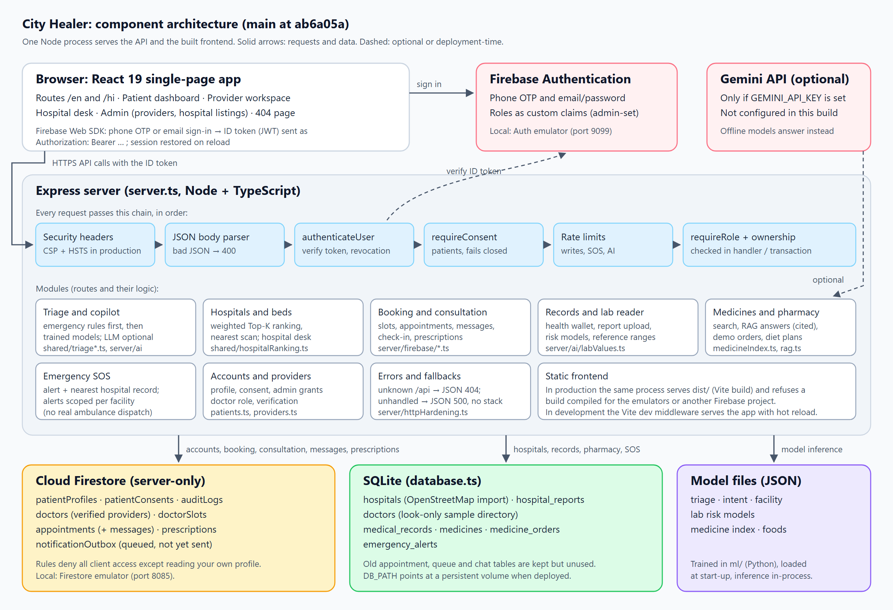
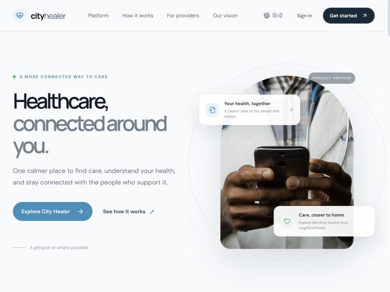
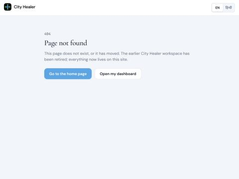

# Milestone 5 – System Architecture and Integration

**Project:** City Healer, an integrated emergency and care platform for Delhi NCR
**Repository:** github.com/Raghav-prog-max/city-healer
**Rubric criterion:** Project Implementation – Synchronization of Design & Implementation (27–31 Oct)
**Version:** final draft, 17 Nov 2026. It describes `origin/main` at commit `55443ec`, the merge of PR #16 at 16 Nov 2026 23:12 UTC. File:line references were checked against that commit. Numbers in square brackets refer to the References (5.15). Evidence IDs (E-xx) refer to `../EVIDENCE_REGISTER.md`.

---

## 5.1 Abstract

City Healer is one Node.js/Express process that serves a React 19 single-page application and a REST API.

- **Identity:** provided by Firebase Authentication.
- **Cloud Firestore holds:** patient profiles, consents, the audit log, verified doctors, slots, appointments (with their messages and check-in state) and prescriptions.
- **SQLite holds:** hospital listings, the 80-entry sample doctor directory, the medicine catalogue and orders, health records and emergency alerts.
- **AI:** all AI features run in-process on models trained in the repository. An optional LLM path (A1) exists but is off without a `GEMINI_API_KEY`, which is the current set-up, and it has never been run against the real API.

Every non-public request goes through a fixed chain before it reaches a module:

1. security headers;
2. a JSON parser that returns JSON errors;
3. per-user write limits;
4. Firebase token verification;
5. a consent gate for patients;
6. a role guard, where the route needs one.

The audit found two appointment systems, a legacy app, no staff screens and a non-JSON 404 (audit, 16 Nov 2026). All of these were removed or added by PRs #8–#12.

Three deviations from the Milestone 3 plan remain, each with its reason in 5.7.4:

- Firebase Authentication instead of bcrypt + JWT.
- Trained models instead of a paid LLM.
- A Firestore + SQLite split instead of SQLite alone.

## 5.2 Objectives

The architecture serves the objectives of Milestone 3 (3.2) as follows:

| # | Objective | Architectural element |
|---|---|---|
| O1 | Bilingual triage with an emergency flag | Shared triage library (`shared/triage.ts`, `shared/emergencySafety.ts`, `shared/triageModel.ts`); optional LLM wrapper `server/ai/llm.ts:286` |
| O2 | Top-3 hospitals | `recommendHospitals()` `server.ts:348`, which uses `shared/hospitalRanking.ts` |
| O3 | Owner-only bed census | `PUT /api/hospitals/:id/beds` (`server.ts:515`) plus the Hospital workspace |
| O4 | Booking, queue, chat, prescription | Firestore routers: `booking.ts`, `consultations.ts`, `messages.ts`, `checkin.ts` |
| O5 | SOS | `POST /api/emergency/sos` (`server.ts:1059`); alerts scoped per facility (`server.ts:1123-1160`) |
| O6 | Privacy across 4 roles | Token, consent, role and ownership checks; Firestore deny-by-default rules |
| O7 | Usable without AI services | In-process models; the LLM path falls back offline (A9) |

## 5.3 Introduction

Milestone 3 (3.4) proposed three tiers and five modules behind one role-checked API, built on React + Express + SQLite with a pre-trained model reached through an API. From September to November 2026 the system was rebuilt in stages, as the git history of `origin/main` shows:

1. In-repo trained models replaced the planned API model (`c6921ec`).
2. Identity moved to Firebase (`fba9063`).
3. The audit's release blockers were fixed (PRs #5–#7).
4. Patients and doctors moved onto one Firestore appointment system (PRs #8–#11).
5. The legacy app was removed (PR #12).
6. The Milestone 4 algorithms were completed (PR #13).
7. The remaining features and hardening were added (PR #14), followed by messages and check-in (PR #15) and session restore on reload (PR #16).

## 5.4 Requirements

### 5.4.1 Functional requirements and where they are met

| ID | Requirement | Where it is met (`55443ec`) |
|---|---|---|
| FR1 | Symptoms in English, Hindi or romanised Hindi | `POST /api/symptoms/check` `server.ts:1176`; `POST /api/ai/copilot` `server.ts:1276` |
| FR2 | Urgency, specialist and SOS flag in every reply | `triage()` `shared/triageModel.ts:180`; `llmTriage()` `server/ai/llm.ts:286` |
| FR3 | Top-3 hospitals | `server.ts:348-380`; `shared/hospitalRanking.ts:42`, `:74` |
| FR4 | Booking, cancel, reschedule | `server/firebase/booking.ts:141`, `:163`, `:241` |
| FR5 | Prescription saved and downloadable | `server/firebase/consultations.ts:137`; PDF in `src/site/lib/prescriptionPdf.ts:95` |
| FR6 | Medicine ordering | `POST /api/medicines/order` `server.ts:970`; demo pharmacy `src/site/app/PharmacyOrder.tsx` |
| FR7 | Emergency SOS | `server.ts:1059`; `src/site/app/EmergencyPage.tsx` |
| FR8 | Four roles | `server/firebase/identity.ts:13-37` |
| FR9 | Records and lab analysis | `server.ts:861`, `:885`, `:1208` |
| FR10 | Consultation messages and check-in | `server/firebase/messages.ts:216`; `server/firebase/checkin.ts:147` |

### 5.4.2 Non-functional requirements

| ID | Requirement | Response |
|---|---|---|
| NFR1 | Privacy | Deny-by-default Firestore rules (`firebase/firestore.rules`); all writes go through the server (Admin SDK) |
| NFR2 | No dependency on external AI | In-process models; the LLM is optional and falls back offline |
| NFR3 | Low cost | One process; open-source libraries; emulators for development |
| NFR4 | Safe release builds | `shared/buildEnv.ts`; `Dockerfile`; `railway.json` |
| NFR5 | Abuse resistance | Write limits (`server.ts:181-187`); AI quota (`server.ts:209-237`) |

## 5.5 Methodology

The iterative, incremental method of Milestone 3 (3.5) was kept. Each change went through four steps:

1. Built on a feature branch.
2. Verified with tests, `tsc` and a browser walk-through against the emulators.
3. Reviewed.
4. Merged by pull request, with the verification recorded in the PR body (PRs #5–#16).

The order of work followed the audit's action plan (`CITY_HEALER_AUDIT_REPORT/RECOMMENDED_ACTION_PLAN.md`): P0 release blockers first, then the P1 integration items.

## 5.6 Architecture

### 5.6.1 Component view



Figure 19 is drawn from the text diagram below (source: `../screenshots/fig-19-architecture-diagram.svg`).

```
Browser (React 19 SPA, /en and /hi)
   │  Firebase Web SDK: phone OTP or email → ID token; session restored on reload (PR #16)
   ▼
Express (server.ts, one Node process)
   ├─ securityHeaders: nosniff, frame DENY, referrer, permissions, COOP; HSTS + CSP in production (server.ts:77; server/httpHardening.ts:17-50)
   ├─ express.json 512 kB + bodyParserErrors → JSON 400 INVALID_JSON (server.ts:78-80)
   ├─ authenticateUser: Firebase ID token with revocation (server.ts:128; identity.ts:47)
   ├─ requireConsent: patients, default-deny, fails closed (server.ts:173; consent.ts:54)
   ├─ write limits per user: bookings, records, reports, orders 120/10 min; SOS 10/10 min (server.ts:181-187)
   ├─ requireRole(...) (server.ts:190); aiRateLimit 300/h per user (server.ts:209-237)
   │
   ├─ Triage & copilot ─ shared/triage*.ts, emergencySafety.ts, server/ai/orchestrator.ts, llm.ts (optional)
   ├─ Knowledge (RAG over the medicine index) ─ server/ai/rag.ts, POST /api/v1/knowledge/ask (server.ts:1294)
   ├─ Hospitals & beds ─ recommendHospitals(), Hospital workspace ──► SQLite
   ├─ Booking, consultation, messages, check-in ─ server/firebase/*.ts ──► Firestore
   ├─ Records, lab reader ─ server/ai/labValues.ts, shared/labModels.ts ──► SQLite
   ├─ Medicines, pharmacy, diet ─ medicineIndex.ts, /api/medicines/*, dietRecommender.ts ──► SQLite / JSON
   ├─ Emergency ─ /api/emergency/sos, /api/emergency/alerts (per-facility) ──► SQLite
   └─ Unknown /api route → JSON 404 (server.ts:1467); finalErrorHandler → JSON 500 without stack (server.ts:1495)
   ▼
Static frontend (dist/) served by the same process (server.ts:1488)
```

### 5.6.2 Request path

1. The browser sends `Authorization: Bearer <Firebase ID token>`.
2. `authenticateUser` (`server.ts:128`) lets the public routes through (`PUBLIC_ROUTES`, `server.ts:113`). For every other route it verifies the token with revocation checking. A rejected token gets 401; failing to reach Firebase gets 503.
3. `requireConsent()` (`consent.ts:54`) refuses a patient who has no valid, current consent with `403 CONSENT_REQUIRED`. The exempt routes are listed in `consent.ts:22-31` and include `POST /api/emergency/sos`.
4. The route-level guards then apply: `requireRole`, the write limits and `aiRateLimit`.
5. Ownership is checked inside the handler or inside the Firestore transaction.

### 5.6.3 Data stores

| Store | Holds | Client access |
|---|---|---|
| Firestore | `patientProfiles`, `patientConsents`, `auditLogs`, `doctors`, `doctorSlots`, `appointments` (+ `messages` subcollection), `prescriptions`, `notificationOutbox` | None, except a patient reading their own profile and consents (`firebase/firestore.rules`) |
| SQLite (`database.ts`) | `hospitals`, `doctors` (sample directory), `hospital_reports`, `medical_records`, `medicines`, `medicine_orders`, `emergency_alerts`, `users`; the old `appointments`/`queue_tokens`/`chat_messages` tables are kept but no longer used or seeded (PR #12) | Server only |
| JSON artefacts | `shared/*-model.json`, `models/medicine-index.json`, `models/foods.json` | Loaded at start-up |

### 5.6.4 Frontend routes (`src/site/SiteRouter.tsx:84-104`)

| Route | Screen | Guard |
|---|---|---|
| `/<l>` | Landing | – |
| `/<l>/sign-in` | Sign-in | – |
| `/<l>/get-started` | Onboarding | – |
| `/<l>/dashboard/*` | Patient dashboard | `RequireAuth` |
| `/<l>/provider` | Provider workspace | `DOCTOR` |
| `/<l>/hospital` | Hospital workspace | `HOSPITAL` |
| `/<l>/admin/providers` | Provider review | `ADMIN` |
| `/<l>/admin/hospitals` | Hospital listings review | `ADMIN` |
| `/<l>/emergency` | Emergency | Public |
| `/<l>/models` | Model cards | Public |
| `*` | Bilingual 404 page (`NotFoundPage`) | – |

The legacy app (`src/App.tsx`) and its localStorage fallback (`src/utils/api.ts`) no longer exist on `origin/main` (PR #12).

## 5.7 Implementation (integration)

### 5.7.1 Integrated end to end (verified in PR bodies and tests)

- **Onboarding:** sign-in → onboarding → consent → dashboard (PR #5); reload keeps the page (PR #16).
- **Care routing:** triage or the copilot lists verified doctors first, then look-only directory doctors (PR #8; test "triage and the copilot recommend the verified provider first, and only it is bookable").
- **Provider onboarding:** the admin grants the doctor role, the doctor applies, the admin verifies, the doctor publishes slots and a patient books (PR #9).
- **Consultation:** the doctor completes the visit, cancels, prescribes and reads records through the booking (PR #10).
- **Refusal:** refusing a doctor cancels their upcoming appointments (PR #11).
- **Messages and check-in:** both work through the booking (PR #15; browser walk-through recorded).
- **Prescription → order:** a prescription can be downloaded as a PDF or attached to a demo pharmacy order (PR #14).
- **SOS:** each alert is routed to the nearest hospital and is visible only to that hospital's desk and to admins (PR #12).

### 5.7.2 Simulated or not integrated

| Item | Status | Evidence |
|---|---|---|
| Ambulance dispatch | Simulated. The server picks the nearest hospital and records a random ambulance reference. The Emergency page tells the user to call 112 and does not claim that help was sent. | `server.ts:1059-1110`; `EmergencyPage.tsx:1-5` |
| Notifications | Queued in `notificationOutbox`; never delivered | PRs #11, #15 |
| Pharmacy | Demo only: no payment, no delivery | PR #14 |
| Hospital IT, live beds, ABHA/ABDM | Not integrated. Beds count as "not reported" until a hospital desk updates them; beds and directory doctors are labelled as sample data in the UI. | README "Scope"; coordinator's final facts |
| Real Firebase project, deployment | None. All runs used local emulators. | Audit TEST_EXECUTION_LOG; PR #7 |
| LLM (A1/A8/A10) | Code present, off without a key; never run against real Gemini | PR #13 |

### 5.7.3 Merged pull requests (final state)

| PR | Merged (UTC, 2026) | Integration content |
|---|---|---|
| #5–#7 | 16 Nov 16:35 | P0.2 consent enforcement, P0.3 lab reader, P0.4 Docker env |
| #8 | 16 Nov 17:07 | One appointment system (patient side) |
| #9 | 16 Nov 17:29 | Doctor and admin screens for provider onboarding |
| #10 | 16 Nov 17:56 | Doctor clinical core on Firestore |
| #11 | 16 Nov 22:07 | Refusal cancels upcoming appointments |
| #12 | 16 Nov 22:36 | SQLite booking and legacy app retired; Hospital workspace; admin listings; 404; per-facility SOS alerts |
| #13 | 16 Nov 22:46 | Algorithms A1–A14, `docs/ALGORITHMS.md`, emergency-safety suite in `npm test` |
| #14 | 16 Nov 22:56 | Demo pharmacy, prescription PDF, security headers, JSON errors, write limits |
| #15 | 16 Nov 23:06 | Appointment messages, same-day check-in |
| #16 | 16 Nov 23:12 | Session restore on reload; local date on prescriptions |

### 5.7.4 Deviations from the Milestone 1–4 design

| Milestone 1–4 plan | Implemented | Reason (source) |
|---|---|---|
| bcrypt + JWT sessions (A13) | Firebase Authentication. The server verifies RS256 ID tokens with revocation (`identity.ts:47`). bcrypt is used only to detect legacy passwords in `scripts/legacy-passwords.ts`. | No password storage or signing secret on the server; supports phone OTP; revocation takes effect immediately (README "Security"; PR #13; `docs/ALGORITHMS.md` §A13) |
| Role re-read from the database on every request (A12) | Role comes from admin-set custom claims; a role change revokes the account's sessions | Test "an administrator's role change revokes the account's existing sessions" |
| Pre-trained ML model through a paid API (A1) | In-repo trained models answer. The LLM path exists but is off without a key. | Cost, privacy, determinism (commit `c6921ec`; PR #13) |
| SQLite only, 10 tables (3.7) | Firestore for identity-linked and clinical data; SQLite for directory data | Transactions guarantee single booking (audit and final run: exactly 1 of 20 concurrent bookings created in every round); deny-by-default rules |
| 52 seeded hospitals | About 990 NCR listings imported from OpenStreetMap and matched to registries | Build Summary §6; `backend_audit.json` endpoint label "990 listings" |
| Rating term in the hospital score (A5) | Not used | Ratings in the data are unverified (`docs/ALGORITHMS.md` §A5) |
| OPD token with a fixed wait time (A7) | Same-day check-in ordered by booked time, with a wait range | `shared/waitTime.ts:56`; PR #15 |

## 5.8 Algorithms

Where each Milestone 4 algorithm runs is summarised below; Milestone 7 gives the detail.

| # | Location (`55443ec`) | Status |
|---|---|---|
| A1 | `server/ai/llm.ts:286` `llmTriage` | Added; optional; off without a key |
| A2 | `shared/emergencySafety.ts:104`; `shared/triage.ts:406` | Implemented |
| A3 | `shared/triage.ts` term sets and body-part pairs | Implemented |
| A4 | `shared/triage.ts:40` | Implemented |
| A5 | `shared/hospitalRanking.ts:42`, `:74`, `:83` | Implemented (no rating term) |
| A6 | `shared/geo.ts:56` `nearest`, used at `server.ts:1072` | Implemented |
| A7 | `shared/waitTime.ts:56`, used by check-in | Implemented |
| A8 | `server/ai/llm.ts:139`, `:149`, `:176` | Added (LLM path only) |
| A9 | `server/ai/llm.ts:286`; `server/ai/rag.ts:78`; `shared/triageModel.ts:180` | Implemented |
| A10 | `server/ai/rag.ts:44-78` | Added |
| A11 | `server/ai/llm.ts:35`, `:95` | Added |
| A12 | `server.ts:128`, `:190`; `server/firebase/*` | Implemented |
| A13 | Replaced by Firebase ID tokens | Deviation, documented |
| A14 | `server/rateLimit.ts:26`; `server/httpHardening.ts:77` | Implemented |

## 5.9 Technology stack

| Layer | Milestone 3 plan | Implemented |
|---|---|---|
| Frontend | React 19, Vite 6, Tailwind v4, jsPDF, Web Speech API | React 19, Vite 6, Tailwind 4, react-router 7, jsPDF (lazy chunk), Web Speech API |
| Backend | Node 20, Express 4, SQLite3, bcryptjs, jsonwebtoken | Node (TypeScript via tsx/esbuild), Express 4, sqlite3, zod, Firebase Admin SDK |
| Identity and data | – | Firebase Authentication, Cloud Firestore, Firebase Emulator Suite |
| AI/ML | Pre-trained model through an API | scikit-learn training (`ml/`), TypeScript inference (`shared/`), optional Gemini caller (`server/ai/llm.ts:217`) |
| Testing | tsx --test | Node test runner via `tsx --test`; server suites against throwaway emulators |
| Deployment | Docker, Railway | Dockerfile, `railway.json` (not deployed) |

## 5.10 Screenshots

All screenshots were captured from the running app against local emulators with synthetic demo accounts.





## 5.11 Test cases

| TC | Integration check | Test (file: name) |
|---|---|---|
| TC5-01 | Anonymous callers are rejected | `tests/access-matrix.test.ts`: describe "anonymous callers are rejected on every guarded route" |
| TC5-02 | Public routes stay reachable | `tests/access-matrix.test.ts`: "public routes remain reachable without a session" |
| TC5-03 | Retired routes answer 404 | `tests/access-matrix.test.ts`: the test that all 12 removed routes answer 404 (PR #12) |
| TC5-04 | Headers on normal, 404 and auth-refusal responses | `tests/security-headers.test.ts`: "are on a normal response, an unknown API route and an auth refusal" |
| TC5-05 | Malformed JSON → JSON 400 | `tests/security-headers.test.ts`: "malformed JSON is a JSON 400 INVALID_JSON without the parser message" |
| TC5-06 | Verified provider first | `tests/booking.test.ts`: "triage and the copilot recommend the verified provider first, and only it is bookable" |
| TC5-07 | Production server refuses an emulator build | `tests/build-env.test.ts`: "a frontend built for emulators is refused by a server on a real project" |

## 5.12 Actual results

- **Final test run** (`npm test` on the code of PR #15 merged with `main`, which is everything except the client-only PR #16): 225 unit tests pass and 309 server tests pass, with 0 failures and exit code 0. Source: `../final-npm-test.log`.
- **After PR #16:** `npx tsc` is clean and `npm run test:unit` passes 225 of 225 (coordinator's final facts).
- **Final local backend audits** (`results/backend_audit_2026-11-16T2307Z.json`, `results/backend_audit.json` (23:26Z), `results/backend_audit_2026-11-17T0019Z.json` and `results/backend_audit_2026-11-17T0100Z.json`; local emulators, not production):
  - cold start to healthy took 3.4–5.9 s;
  - the Firestore rules probe denied everything except a patient reading their own profile;
  - 20 concurrent bookings per round created exactly 1 booking with 19 conflicts, in every round;
  - every load-test row had a 0 % error rate.
- **Audit integration score:** 50/100 on 16 Nov 2026, measured before PRs #8–#16 (`results/scorecard.json`). The findings behind it were fixed by those PRs. The score itself has not been recomputed.

## 5.13 Limitations

- The system runs as one process with no horizontal scaling. Rate limits and AI monitoring are kept in memory and reset on restart.
- There are two databases. The hospital desk is linked from a Firebase claim to a SQLite hospital through `hospitalId` and the facility name (`server.ts:1114`).
- Nothing has been deployed, and no real Firebase project exists. The check-in composite index must be deployed before production (PR #15).
- Notifications are queued and never delivered. Ambulance dispatch is simulated. There is no live hospital or ABHA integration.
- Synthetic and public data only. No clinical validation of any component.

## 5.14 Conclusion

The built architecture keeps the shape planned in Milestone 3: one process, one guarded API and separate modules. Three components were replaced by more defensible ones: Firebase identity, in-repo trained models and transactional Firestore booking. Every integration gap the audit found has been closed by a merged pull request, and the final automated run passes.

## 5.15 References

References [1]–[25] are as in the Milestones 1–4 document. Additional references:

26. Google, "Firebase Authentication documentation." https://firebase.google.com/docs/auth (to be checked)
27. Google, "Cloud Firestore: transactions and batched writes." https://firebase.google.com/docs/firestore/manage-data/transactions (to be checked)
28. City Healer system audit, `CITY_HEALER_AUDIT_REPORT/` (16 Nov 2026; results re-generated 16 Nov 2026 22:57–23:07 UTC), in [25].
29. City Healer, `docs/ALGORITHMS.md`, in [25].
