# Milestone 6 – Core Module Implementation

**Project:** City Healer · **Repository:** github.com/Raghav-prog-max/city-healer
**Rubric criterion:** Project Implementation – Implementation & Demonstration of Modules (27–31 Oct)
**Version:** final draft, 17 Nov 2026. Describes `origin/main` at `55443ec`. Evidence IDs (E-xx) refer to `../EVIDENCE_REGISTER.md`.

---

## 6.1 Abstract

This milestone documents each core module of City Healer. For every module it gives the routes and source files, the screens and the automated tests, and it states plainly what is simulated. The modules are:

1. Identity, onboarding and consent
2. Symptom triage and the health copilot
3. Hospital discovery and bed census
4. Verified-doctor booking, consultation, messages, same-day check-in and prescriptions (with PDF)
5. Health records and lab-report reading
6. Medicines, demo pharmacy and nutrition
7. Emergency SOS
8. Staff workspaces for doctors, hospital desks and administrators
9. Bilingual interface and voice

All modules are merged. The final automated run passed 225 unit and 309 server tests with 0 failures (`../final-npm-test.log`).

## 6.2 Objectives

| # | Objective (Milestone 3) | Module | Status at `55443ec` |
|---|---|---|---|
| O1 | Bilingual triage with an emergency flag | 6.7.2 | Met |
| O2 | Top-3 hospitals | 6.7.3 | Met. The rating term is not used (ratings are unverified). |
| O3 | Owner-only bed and ICU census | 6.7.3, 6.7.8 | Met. Enforced on the server and editable in the Hospital workspace. |
| O4 | Booking, queue token, chat, prescription saved and PDF | 6.7.4 | Met. The queue token was replaced by same-day check-in with a wait range (A7). The prescription PDF cannot render Devanagari. |
| O5 | SOS from the patient's location | 6.7.7 | Partly met. The alert reaches the nearest hospital's desk. No ambulance is dispatched, and the app tells the user to call 112. |
| O6 | Privacy across 4 roles | 6.7.1; Milestone 9 | Met |
| O7 | Usable when AI fails | 6.7.2 | Met. Models run in-process and the LLM path falls back offline. |

## 6.3 Introduction

The patient application lives under `src/site/`. The earlier application (`src/App.tsx`, `src/utils/api.ts` and the components only it used) was deleted in PR #12, and an unknown URL now shows a bilingual 404 page.

## 6.4 Requirements

The functional requirements FR1–FR10 are listed in Milestone 5 (5.4.1). The demonstration requirement is covered by `../DEMO_SCRIPT.md`.

## 6.5 Methodology

Each module went through the same steps:

1. A zod schema in `server/firebase/*.ts` or `server.ts`.
2. A server route behind the guards.
3. A screen in `src/site/`.
4. Server tests against throwaway emulators.
5. A browser walk-through, recorded in the PR body.
6. A review. PRs #11 and #15 describe multi-lens reviews whose findings were fixed before merge.

## 6.6 Architecture

See Milestone 5 (5.6). The source layout is:

- `shared/`: pure logic shared by server, browser and tests.
- `server/firebase/`: Firestore routers.
- `server/ai/`: AI modules.
- `server/httpHardening.ts` and `server/rateLimit.ts`: hardening.
- `server.ts`: SQLite routes and wiring.
- `src/site/`: screens.

## 6.7 Implementation

### 6.7.1 Identity, onboarding and consent

- **Sign-in.** Firebase phone OTP or email (`src/site/auth/SignInPage.tsx`, `src/site/onboarding/Onboarding.jsx`). The session waits for Firebase's first auth report before routing, and staff return to the page they asked for (PR #16, `src/site/lib/session.tsx`).
- **Token check.** `verifyFirebaseToken()` with revocation (`server/firebase/identity.ts:47`).
- **Profile and consent.** `/api/v1/me` routes (`server/firebase/patients.ts`). Consent is a series of append-only events (`shared/consent.ts:32`), enforced by `requireConsent()` (`server/firebase/consent.ts:54`, mounted at `server.ts:173`).
- **Tests.** `tests/consent.test.ts`, for example "accepting the current versions unlocks patient routes at once"; `tests/consent-rules.test.ts`; `tests/access-matrix.test.ts` "GET /api/v1/me returns the caller's identity and own profile".

### 6.7.2 Symptom triage and health copilot

- **Triage.** `POST /api/symptoms/check` (`server.ts:1176`) calls `llmTriage()` (`server/ai/llm.ts:286`). Without a `GEMINI_API_KEY`, which is the current set-up, it makes no network call. It returns the offline result of `triage()` (`shared/triageModel.ts:180`) with `engine: "offline"`. The offline chain is:
  1. Emergency rules first.
  2. The trained model, when confidence is at least 0.40 and at least 3 input terms are known (`triageModel.ts:38`).
  3. Otherwise the keyword rules, which answer "not assessed" when they recognise nothing.
- **After triage.** `recommendHospitals()` and `recommendDoctors()` add the top-3 hospitals and doctors (verified doctors first).
- **Copilot.** `POST /api/ai/copilot` and `/api/v1/copilot/chat` (`server.ts:1276`, `:1318`) call `orchestrate()` (`server/ai/orchestrator.ts:77`). The order is safety rules, then the intent classifier (threshold 0.35), then routing to triage, lab, medicine, diet or care lookup. The reply is a template in English or Hindi.
- **Self-harm.** Gets crisis wording with Tele-MANAS 14416 and 112 (`shared/emergencySafety.ts:111`).
- **Knowledge questions (A10).** `POST /api/v1/knowledge/ask` (`server.ts:1294`) answers only from retrieved medicine passages, cited as [M1], [M2] and so on. It declines when nothing is retrieved (`server/ai/rag.ts:44-78`).
- **Screens.** `src/site/app/AssistantPage.tsx` (text and voice).
- **Tests.** `tests/triage-heuristic.test.ts`, `tests/triage-model.test.ts`, `tests/ai-models.test.ts`, `tests/emergency-safety.test.ts` (in `test:unit` since PR #13) and `tests/algorithms.test.ts` (for example "A9: no key configured means exactly the offline result plus engine: offline").

### 6.7.3 Hospital discovery and bed census

- **Listing.** `GET /api/hospitals` (`server.ts:444`) serves about 990 NCR listings. The final audit measured a 51 KB payload, down from 918 KB at the first audit (`backend_audit.json` `hospitals_payload_kb`).
- **Ranking.** `server.ts:348-380` uses `scoreHospital`, `topK` and `scorePercent` (`shared/hospitalRanking.ts:42`, `:74`, `:83`). The result is the top 3 with distance, travel-time estimate and match reason.
- **Bed census.** `PUT /api/hospitals/:id/beds` is limited to `HOSPITAL`/`ADMIN` and to the caller's own facility (`server.ts:515`). The Hospital workspace (`src/site/staff/HospitalWorkspace.tsx`) reads the facility from `GET /api/v1/hospital/facility` (`server.ts:573`).
- **Listing quality.** Patients report a listing; admins review it in `/en/admin/hospitals` (`src/site/staff/AdminHospitals.tsx`).
- **Tests.** `tests/access-matrix.test.ts` ("recommended hospitals have a department for the condition", "hospitals come back nearest first when a position is given", "HOSPITAL may write the bed census -> 200", "no hospital starts with invented bed or ICU counts"); `tests/algorithms.test.ts` ("A5: a hospital with the needed department outranks a nearer one without it").

### 6.7.4 Booking, consultation, messages, check-in and prescriptions

- **Provider onboarding.** The admin grants the doctor role; the doctor applies; the admin verifies or refuses; the doctor publishes non-overlapping future slots (PR #9; `server/firebase/providers.ts`).
- **Booking.** `createAppointment()` (`server/firebase/booking.ts:141`) runs one Firestore transaction. Cancel (`:163`) and reschedule (`:241`) are transactions too. Refusing a doctor cancels their upcoming appointments (`:208`, PR #11).
- **Consultation.** Complete, doctor cancel, write a prescription once, read the patient's records inside a window from 24 h before to 14 days after the appointment (`server/firebase/consultations.ts:40-41`, `:107`, `:122`, `:137`).
- **Messages** (PR #15, `server/firebase/messages.ts`):
  - One thread per booking, capped at 200 messages (`:50`).
  - There is no AI reply.
  - Each patient message is checked by the deterministic emergency rules. A flagged message gets a stored "City Healer automatic notice" telling the patient to call 112 or use SOS, and the booking is marked urgent (`safetyNoticeFor`, `:143`).
  - A standing notice says messages are not monitored live.
- **Same-day check-in** (PR #15, `server/firebase/checkin.ts`):
  - For confirmed in-person bookings on the Asia/Kolkata day, from 60 minutes before the start (`:45`).
  - At most 3 check-ins (`:47`).
  - The queue is ordered by booked time. The patient sees how many patients are ahead and a rough wait range (A7, `shared/waitTime.ts:56`).
  - The doctor marks a patient as called or not here.
- **Prescription PDF.** `src/site/lib/prescriptionPdf.ts:95`; jsPDF is loaded lazily. It can be downloaded from the patient's health wallet and from the doctor's view (PR #14). Labels are English only, and Hindi text a doctor types would not render.
- **Screens.**
  - Patient: Find care → Book appointment (`src/site/dashboard/BookingPage.jsx`), the Messages modal and the check-in line.
  - Doctor: Provider workspace (`src/site/staff/ProviderWorkspace.tsx`) with the Today card and the Messages panel.
  - Admin: Provider review (`src/site/staff/AdminProviders.tsx`).
- **Tests.**
  - `tests/booking.test.ts` ("a slot is booked once, even when two patients try at the same moment").
  - `tests/provider-admin.test.ts`.
  - `tests/consultations.test.ts` ("it is written once, signed with the booked doctor's name, and completes the appointment").
  - `tests/messages.test.ts` ("an ordinary patient message is stored trimmed, as the patient, and nothing answers it"; "a chest-pain message gets a fixed system notice in the same post, and the booking is marked urgent"; "Hindi text gets the Hindi notice").
  - `tests/checkin.test.ts` ("the check-in window is the slot's IST day, from 60 minutes before start until end"; "the last booked checks in first and is not ahead of anyone").
  - `tests/prescription-pdf.test.ts` ("an A4 PDF with the header, disclaimer, doctor, diagnosis, medicines and instructions").
  - `tests/appointment-thread.test.ts`.

### 6.7.5 Health records and lab-report reading

- **Records.** `GET/POST /api/records` (`server.ts:861`, `:885`), scoped to the owner. Doctors read records only through a booking (PR #12).
- **Lab analysis.** `POST /api/records/analyze` (`server.ts:1208`) uses `shared/labModels.ts`.
- **Report reader.** `POST /api/v1/documents/extract` (`server.ts:1352`) feeds `server/ai/labValues.ts`. It reads TXT only (PDF only if `pdfjs-dist` is installed; there is no OCR). Pre-filled values must be confirmed before analysis (PR #6).
- **Screen.** Health wallet (`src/site/app/WalletPage.tsx`), which also lists prescriptions in the patient's local date (PR #16).
- **Tests.** `tests/lab-values.test.ts`; `tests/booking.test.ts` "a report file is read without being stored".

### 6.7.6 Medicines, demo pharmacy and nutrition

- **Search and guide.** `POST /api/medicines/guide` and `POST /api/medicines/search-nationwide` (`server.ts:1223`, `:925`) over an index of 11,498 products (`server/medicineIndex.ts`).
- **Demo pharmacy** (`src/site/app/PharmacyOrder.tsx`, PR #14). The screen offers:
  - a catalogue with prescription-required badges and stock;
  - a cart and a delivery address;
  - a picker for the patient's own prescriptions;
  - an order button and a My orders list.

  It is clearly labelled as a demo: there is no payment and no delivery. The server (`POST /api/medicines/order`, `server.ts:970`) recomputes the total, refuses prescription-only items without an attached prescription, and checks stock.

  **Known issue:** the server trusts the `prescriptionAttached` flag (`server.ts:1017`). It does not check that the chosen prescription exists or belongs to the caller (PR #14 "Not done").
- **Diet plan.** `POST /api/diet/recommend` (`server.ts:1250`) uses `server/dietRecommender.ts`.
- **Tests.** `tests/ai-models.test.ts` ("finds products despite misspelling"); the "order integrity" tests, including "the Medicines screen's order (id + quantity, prescription attached) is placed and listed in My orders" (`../final-npm-test.log`).

### 6.7.7 Emergency SOS

- **Public page.** `/<l>/emergency` (`src/site/app/EmergencyPage.tsx`) shows Call 112 and 102 buttons and the nearest emergency hospitals. It states that City Healer has no dispatch partner (`EmergencyPage.tsx:1-5`).
- **SOS route.** `POST /api/emergency/sos` (`server.ts:1059`):
  - finds the nearest hospital with `nearest()` (A6, `server.ts:1072`);
  - stores the alert;
  - records a simulated ambulance reference.

  The route is exempt from consent and limited to 10 calls per 10 minutes per user (`server.ts:183`).
- **Alerts.** A hospital desk sees and updates only the alerts routed to its own facility; admins see all of them (`server.ts:1123-1160`, PR #12).
- **Tests.** `tests/access-matrix.test.ts` "a hospital desk sees and updates only the SOS alerts routed to its own facility"; "the dispatch state machine" ("an invalid alert status is rejected -> 400"); `tests/consent.test.ts` "after withdrawing, the account, SOS and public browsing still work"; `tests/algorithms.test.ts` "A6: picks the closest point and reports its distance".

### 6.7.8 Staff workspaces

| Screen | Route | PR |
|---|---|---|
| Provider workspace: bookings, Today card, messages, prescriptions | `/<l>/provider` | #9, #10, #15 |
| Provider review | `/<l>/admin/providers` | #9, #11 |
| Hospital workspace: own facility, beds/ICU, SOS alerts | `/<l>/hospital` | #12 |
| Hospital listings review | `/<l>/admin/hospitals` | #12 |

### 6.7.9 Bilingual interface and voice

- **Languages.** `/en` and `/hi` routes; strings in `src/site/i18n/messages.ts`.
- **Reply language.** Devanagari input gets a Hindi reply (`shared/triage.ts:40`). Romanised Hindi (Hinglish) is understood by the models and rules (Figure 3).
- **Review.** Each PR from #5 to #15 states that the new Hindi strings need review by a fluent speaker.
- **Voice.** Browser Web Speech API (`src/site/lib/speech.ts`). Not evaluated.

## 6.8 Algorithms

See Milestone 7. A5 lives in `shared/hospitalRanking.ts`, A6 in `shared/geo.ts:56`, A7 in `shared/waitTime.ts:56`, and A14 in `server/rateLimit.ts:26` and `server/httpHardening.ts:77`.

## 6.9 Technology stack

As in Milestone 5 (5.9).

## 6.10 Screenshots

All screenshots were captured from the running app (local emulators, synthetic demo accounts, 800×600).

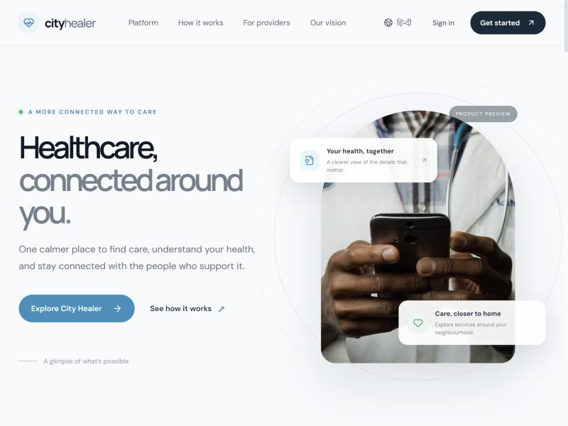
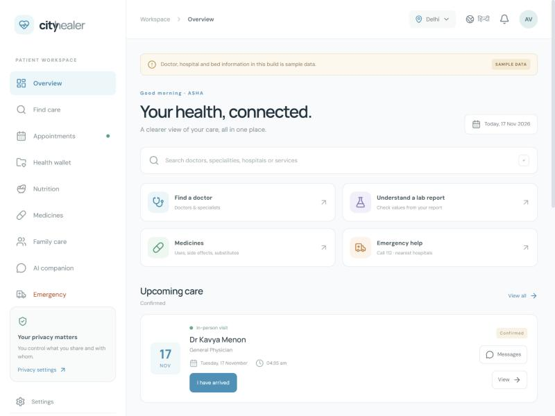
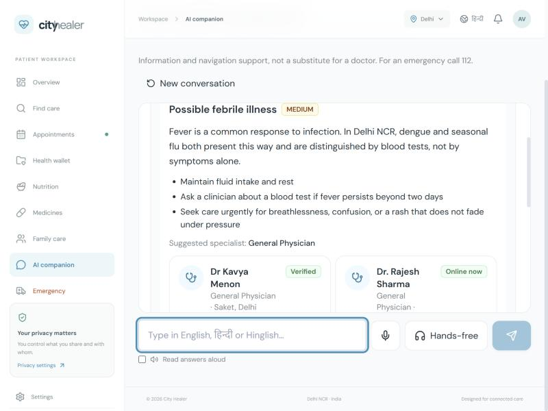
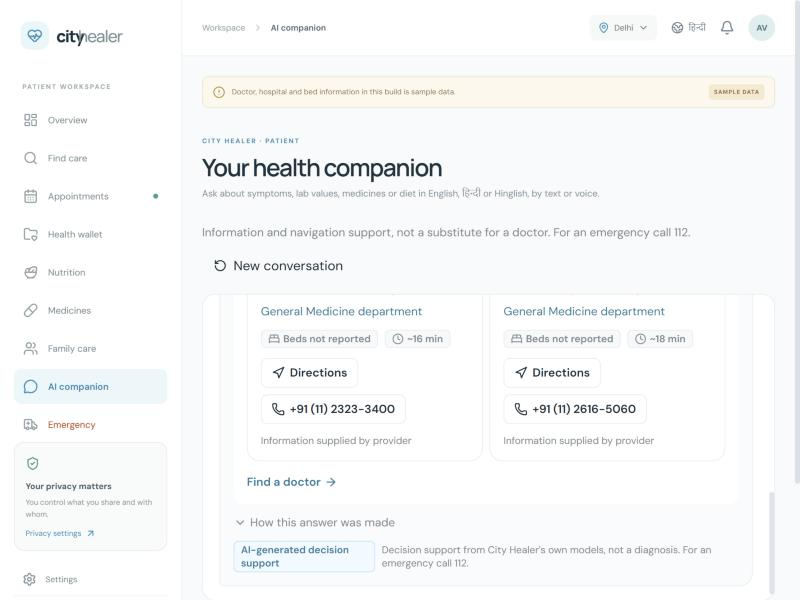
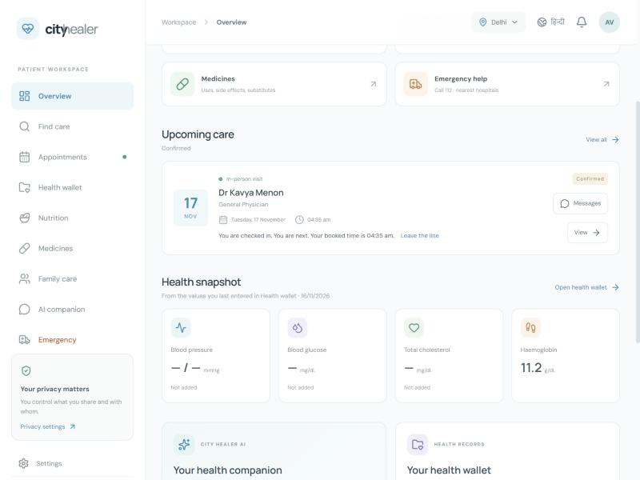
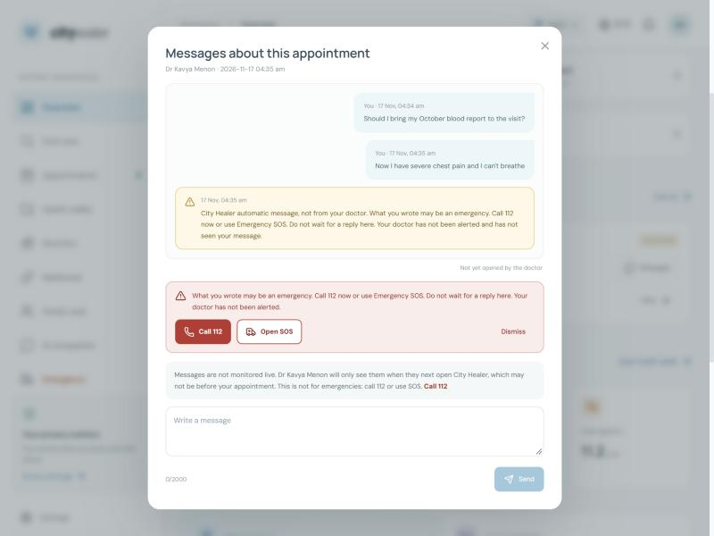
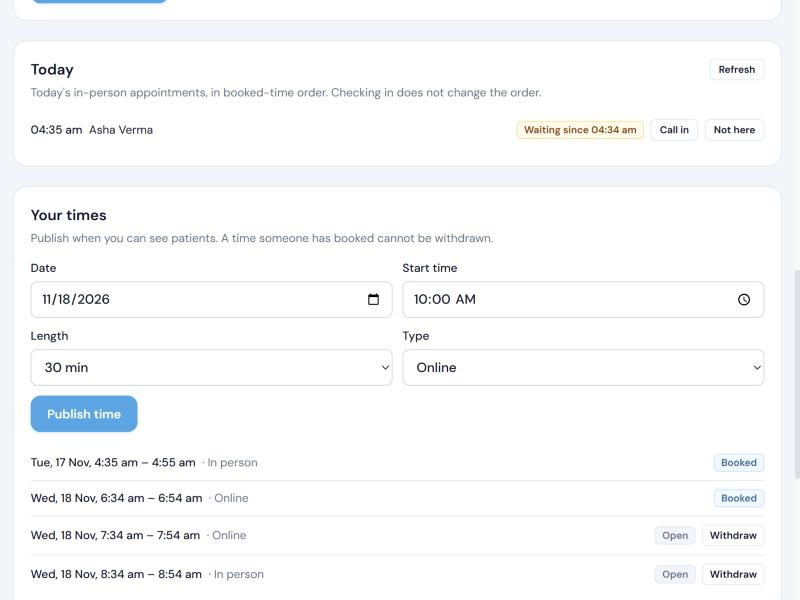
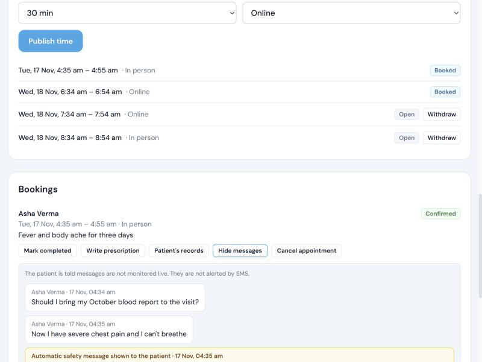
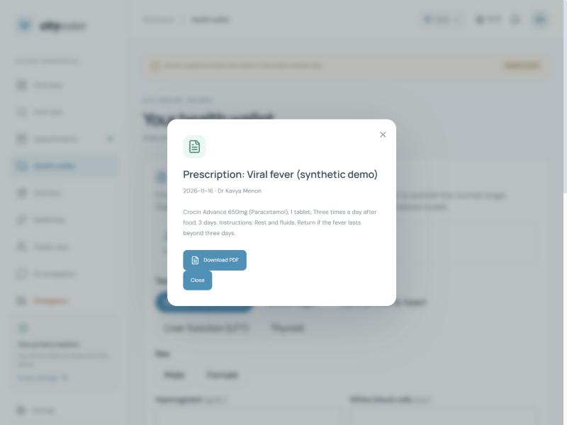
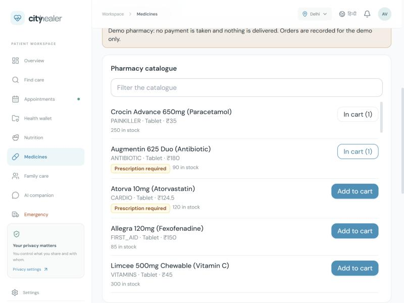
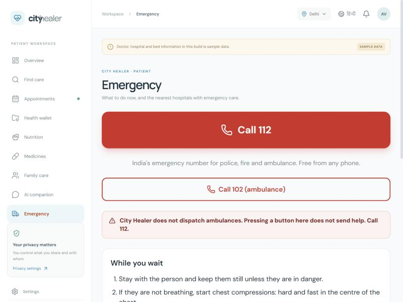
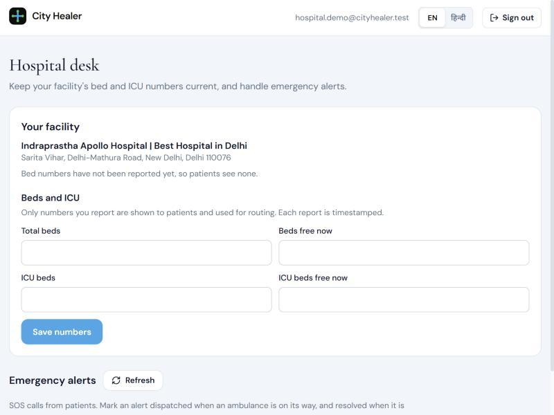
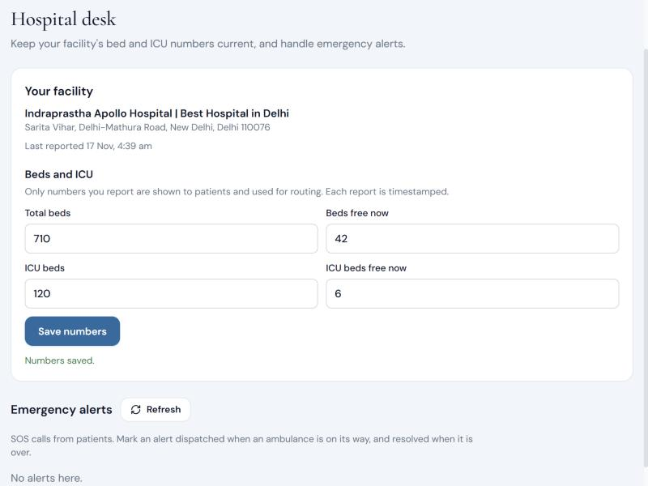
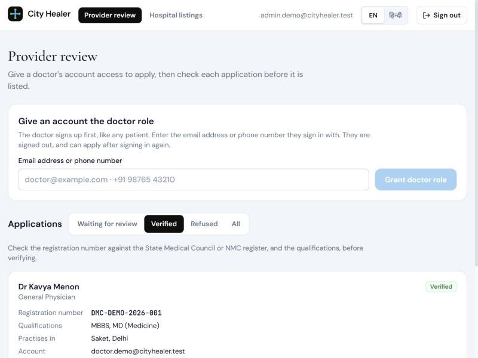
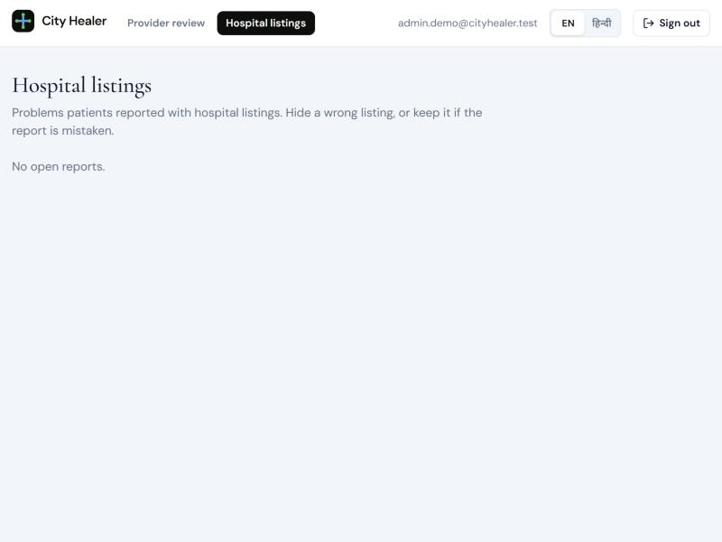
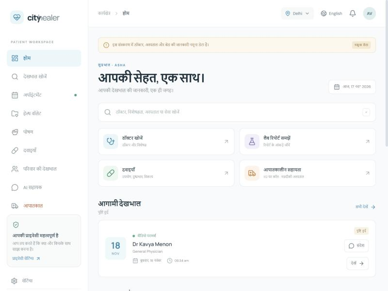
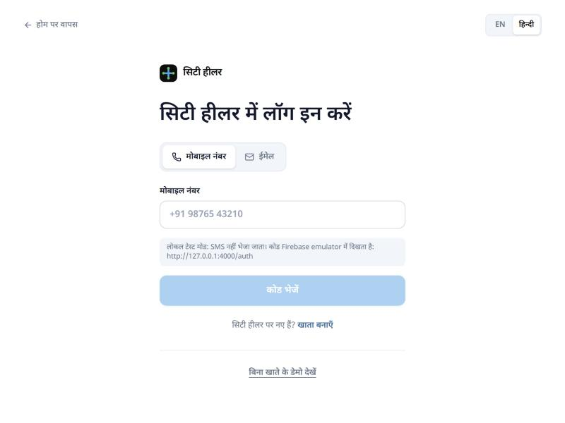

PENDING: Figures 20, 21 and 22.

## 6.11 Test cases

| TC | Module | Input / action | Expected | Test |
|---|---|---|---|---|
| TC6-01 | Consent | Patient without consent calls a data route | 403 `CONSENT_REQUIRED` | `tests/consent.test.ts` "`${method} ${route}` is refused with CONSENT_REQUIRED" |
| TC6-02 | Triage | Cough plus chest pain | Cardio-respiratory, never a cold | `tests/algorithms.test.ts` "A2: cough plus chest pain is treated as cardio-respiratory, never as a cold" |
| TC6-03 | Triage | Romanised Hindi | Matched | `tests/algorithms.test.ts` "A3: romanised Hindi is matched too" |
| TC6-04 | Hospitals | Department vs distance | Department wins | `tests/algorithms.test.ts` "A5: a hospital with the needed department outranks a nearer one without it" |
| TC6-05 | Booking | Two patients, one slot | One booking | `tests/booking.test.ts` "a slot is booked once, even when two patients try at the same moment" |
| TC6-06 | Prescription | Doctor prescribes | Written once, signed | `tests/consultations.test.ts` "it is written once, signed with the booked doctor's name, and completes the appointment" |
| TC6-07 | Messages | Chest-pain message from the patient | Fixed notice, booking marked urgent | `tests/messages.test.ts` "a chest-pain message gets a fixed system notice in the same post, and the booking is marked urgent" |
| TC6-08 | Messages | Ordinary message | Stored; no automatic reply | `tests/messages.test.ts` "an ordinary patient message is stored trimmed, as the patient, and nothing answers it" |
| TC6-09 | Check-in | Booking day in IST | Window opens 60 min before start | `tests/checkin.test.ts` "the check-in window is the slot's IST day, from 60 minutes before start until end" |
| TC6-10 | Wait estimate | No timing data | Equals 12q + 10 | `tests/algorithms.test.ts` "A7: with no timing data it equals the original 12q + 10" |
| TC6-11 | PDF | Prescription | A4 PDF with the required parts | `tests/prescription-pdf.test.ts` |
| TC6-12 | Pharmacy | Prescription-only item without a prescription | 400 | final log: "a prescription-only medicine needs one attached -> 400" |
| TC6-13 | Pharmacy | Order beyond stock | 400 | final log: "ordering beyond available stock is refused -> 400" |
| TC6-14 | SOS alerts | Another facility's alert | Not visible or editable | `tests/access-matrix.test.ts` "a hospital desk sees and updates only the SOS alerts routed to its own facility" |
| TC6-15 | Lab reader | "Platelet Count 1.5 lakh/cumm" | 150,000 | `tests/lab-values.test.ts` "lakh" |

## 6.12 Actual results

- **Final run** (`../final-npm-test.log`, on the code of PR #15 merged with `main`): 225 unit tests pass, 309 server tests pass, 0 fail, exit 0.
- **After PR #16:** `tsc` clean; 225 of 225 unit tests pass (coordinator's final facts).
- **Per-PR runs recorded in PR bodies:**

  | PR | Unit | Server | Note |
  |---|---|---|---|
  | #8 | 162 | 182 | |
  | #9 | 162 | 203 | |
  | #10 | 162 | 225 | |
  | #11 | 162 | 244 | |
  | #12 | 157 | 228 | Counts from the coordinator; the PR body defers to a merge comment |
  | #13 | 193 | 231 | Before the emergency-safety suite was added to `test:unit` |
  | #14 | 207 | 239 | |
  | #15 | 225 | 309 | |

- **Browser walk-throughs** are recorded in PR #15 ("check-in shows 'You are next'"; an emergency message produced the automatic notice and the red banner) and PR #16 (direct visits stay on admin pages). The staff pages from PR #12 were "not yet checked in a browser" when PR #12 merged. Figures 12–15 were captured later from the running app.
- **Screenshots:** Figures 1–18 have been captured.

## 6.13 Limitations

- Notifications are queued, never delivered.
- SOS does not dispatch an ambulance; the app tells users to call 112.
- The pharmacy is a demo with no payment or delivery. The order route trusts `prescriptionAttached`.
- The prescription PDF cannot render Devanagari.
- Reports are read from TXT only; there is no OCR.
- Hospital beds and directory doctors are sample data and are labelled as such in the UI. All accounts are synthetic.
- Hindi wording needs fluent review.
- The post-vs-cancel race test in the messages suite may not catch the regression it targets (PR #15 "Notes").
- There is no Settings button to withdraw consent (PR #5); the endpoint exists and is tested.

## 6.14 Conclusion

Every module of the Milestone 1 patient journey is implemented, connected and covered by automated tests:

symptoms → triage → top-3 hospitals → doctor → booking → check-in → consultation messages → prescription (with PDF) → medicine order → health record.

The staff workspaces for doctors, hospital desks and administrators are complete. What remains simulated is stated in 6.13.

## 6.15 References

[1]–[25] as in Milestones 1–4; [26]–[29] as in Milestone 5.
