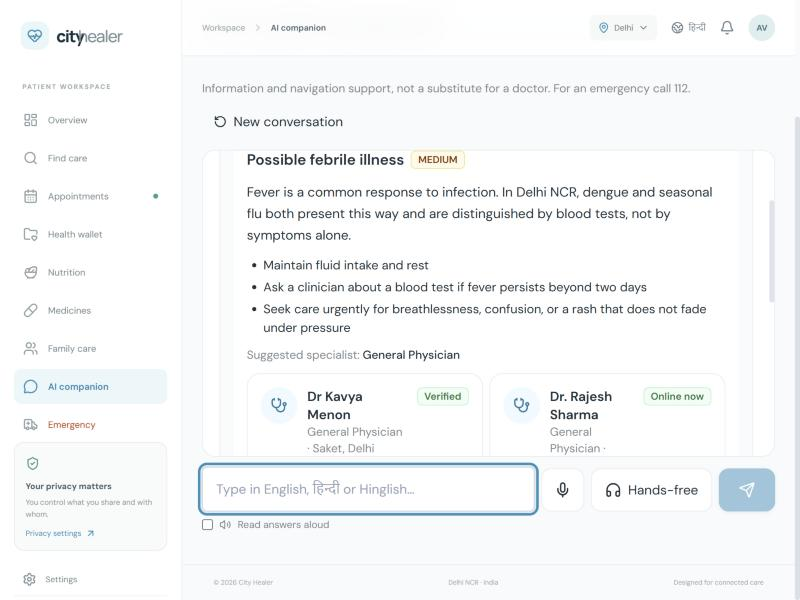
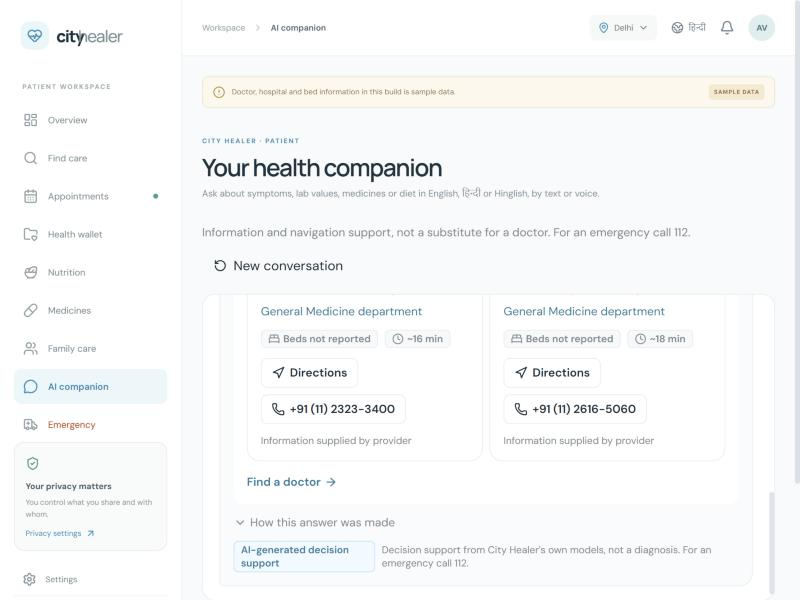
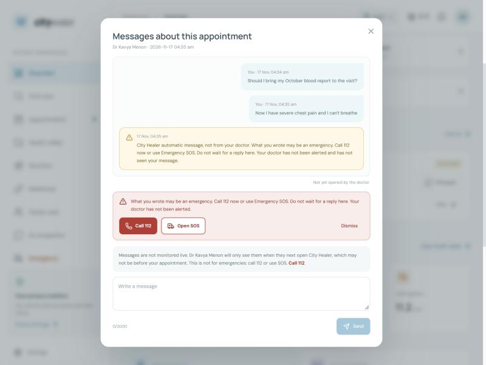
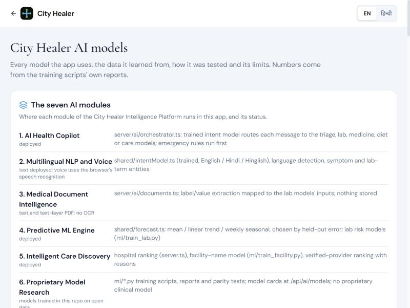
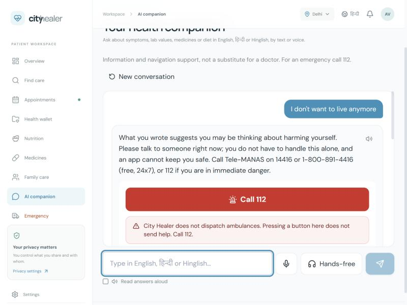
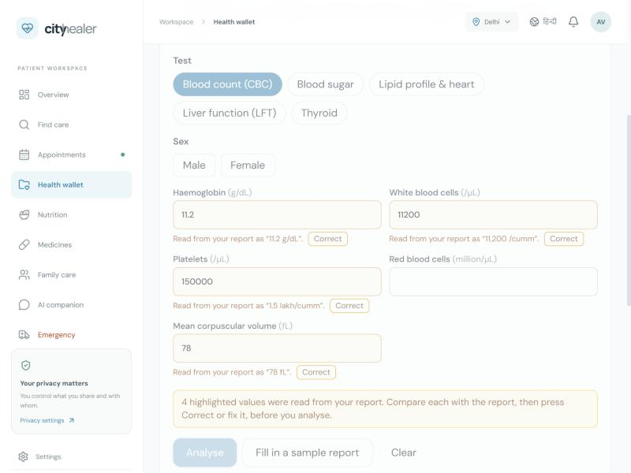

# Milestone 7 – AI/ML Algorithms and Intelligence

**Project:** City Healer · **Repository:** github.com/Raghav-prog-max/city-healer
**Rubric criteria:** Project Design – Relevance of Algorithms / Techniques; Project Implementation – Synchronization of Design & Implementation
**Version:** final draft, 17 Nov 2026. It describes `origin/main` at `55443ec` and draws on `docs/ALGORITHMS.md` (added in PR #13). Note that the line numbers in `docs/ALGORITHMS.md` refer to the PR #13 commit; this report uses line numbers checked at `55443ec`. Evaluation figures come from `CITY_HEALER_AUDIT_REPORT/results/`, files generated on 16 Nov 2026 between 22:57 and 23:07 UTC (17 Nov, 04:27–04:37 IST), unless another source is named.

---

## 7.1 Abstract

City Healer answers health questions with three kinds of engine (`docs/ALGORITHMS.md`, opening):

- **Deterministic emergency rules.** These always run first.
- **Small classical models trained in the repository.** TF-IDF with logistic regression, logistic regression on lab data, gradient boosting with K-means, and TF-IDF retrieval.
- **Templated replies.**

An optional LLM path (A1, with A8, A9 and A11) and retrieval-augmented answering (A10) were added in PR #13. With no `GEMINI_API_KEY`, which is the current set-up, the LLM path makes no network call and returns the offline result. It has never been run against the real Gemini API; all of its tests use fake callers.

All fourteen algorithms planned in Milestone 4 now have source code, a call site, tests and documentation. The one exception is A13 (bcrypt + JWT), which is a documented deviation: sign-in uses Firebase ID tokens instead.

Final measured results:

| Measure | Result |
|---|---|
| Emergency recall, development set | 100 % (n = 36) |
| Emergency recall, held-out set | 100 % (n = 24) |
| False positives on non-emergency messages | 5.7 % (2 of 35) |
| Triage, public test | 95.3 % |
| Triage, fresh test | 93.6 % |
| Intent model, held-out | 93.8 % |
| Copilot route accuracy (audit set) | 81.1 % |
| Lab-report field precision and recall | 96.4 % each |

None of this is clinically validated.

## 7.2 Objectives

1. O1: every symptom input gets an urgency level, a specialist and an SOS flag, and red flags always give CRITICAL.
2. O2: hospitals are ranked by department evidence, beds/ICU and distance, and the top 3 are returned.
3. O7: every AI route answers without any external service.
4. Every algorithm is implemented, tested and documented, and every result is reported with its source.

## 7.3 Introduction

Milestone 4 put an LLM at the centre (A1), with reliability techniques around it (A8–A11). In November 2026 the primary engine became models trained in the repository (commit `c6921ec`). The reasons were cost (no paid API), privacy (symptom text stays on the server) and determinism.

PR #13 then implemented the LLM path as an optional layer. Its two key properties are:

- The emergency rules run first and override any model output.
- With no key, the response is exactly the offline result plus `engine: "offline"`.

## 7.4 Requirements

| Requirement | Evidence |
|---|---|
| Red flags win over any model | `tests/algorithms.test.ts` "A2: emergency rules override the LLM - the model is never called" |
| Unknown input is not given a confident diagnosis | "A2: unrecognised input is not guessed" |
| CRITICAL always raises SOS | "A1: CRITICAL from the model always raises the SOS flag" |
| Hindi and romanised Hindi are understood | "A3: Devanagari chest + pain with an adjective in between still escalates"; "A3: romanised Hindi is matched too" |
| TypeScript inference matches scikit-learn | `tests/triage-model.test.ts`, `tests/ai-models.test.ts`, `tests/facility-model.test.ts` |
| No answer from memory when nothing is retrieved | "A10: nothing retrieved means abstain, not an answer from memory" |

## 7.5 Methodology

1. **Data.** Public datasets with recorded licences, plus small project-written supplements for Hindi and everyday phrasing (`ml/README.md`).
2. **Training.** Python 3.13 and scikit-learn scripts in `ml/` write JSON weights. Classifiers were compared by 5-fold cross-validation, and logistic regression was exported because it gives a probability for each class.
3. **Inference.** Re-implemented in TypeScript (`shared/textClassifier.ts`, `shared/triageModel.ts`, `shared/intentModel.ts`, `shared/labModels.ts`, `shared/facilityModel.ts`), with parity tests against `ml/parity.json`.
4. **Safety evaluation.** The draft emergency set (`tests/fixtures/emergency_safety_set.json`) has development, held-out and non-emergency parts. It is measured by `audit_scripts/eval_emergency.ts`.
5. **Algorithm tests.** `tests/algorithms.test.ts` has 36 tests (PR #13), plus server tests.

## 7.6 Architecture

```
message ─► A2/A3 emergency rules (shared/emergencySafety.ts:104, shared/triage.ts:406) ──match──► CRITICAL + SOS / crisis wording
            │ no match
            ├─ /api/symptoms/check ─► llmTriage (server/ai/llm.ts:286)
            │        ├─ key set: Gemini (A1) with backoff + failover (A8), JSON extraction + zod (A11); any failure → offline (A9)
            │        └─ no key (current): offline triage() (shared/triageModel.ts:180): model ≥ 0.40 → else rules
            ├─ copilot ─► intent classifier (0.35) ─► triage / lab / medicine / diet / care (server/ai/orchestrator.ts:77)
            └─ /api/v1/knowledge/ask ─► retrieve medicine passages (A10, server/ai/rag.ts:44) ─► cited template answer, or abstain
```

## 7.7 Implementation: models and measured results

| Model / component | Method | Data (licence) | Result | Source and date |
|---|---|---|---|---|
| Symptom triage, 22 conditions | TF-IDF word 1–2 grams + multinomial LR | gretelai/symptom_to_diagnosis (Apache-2.0) + project supplement | Public test 95.3 % (macro-F1 95.3). Fresh everyday-language test 93.6 % (macro-F1 93.7). At the 0.40 threshold it answers 57.3 % of fresh-test inputs and is right on 96.8 % of those. Inference p50 0.031 ms. | `ai_ml_evaluation.json`, 16 Nov 2026 22:57 UTC; training figures in `ml/README.md` |
| Copilot intent, 10 intents | TF-IDF + LR | Project-written, en/hi/Hinglish | Held-out 93.8 % (macro-F1 93.8). Robustness set of 20 audit-written sentences: 100 %. Inference p50 0.012 ms. | same |
| Copilot end to end | Rules + intent + routed models + templates | 37 audit-written messages | Route accuracy 81.1 %. Emergency recall 100 %. Emergency false-positive rate 4.8 %. No reply claimed an action. Same input ×10 gives identical replies. | same (pre-fix audit: 70.3 % route accuracy, 75 % recall) |
| Entity extraction | Fixed word list | 12 audit-written sentences | P 93.8 %, R 83.3 %, F1 88.2 % | same |
| Lab-report reader | Pattern extraction (`server/ai/labValues.ts`) | 10 synthetic reports | Field precision 96.4 %, recall 96.4 %. TXT only; PDF returns `dependency_missing`; OCR not implemented. | same (16 Nov audit before P0.3: 84 % / 75 %) |
| Lab risk: diabetes / heart / liver | Logistic regression | Pima/NIDDK (CC0); UCI Cleveland; UCI ILPD (CC BY 4.0) | Test AUC 0.808 / 0.907 / 0.817 | Audit AI_ML_EVALUATION Module 6, from `ml/lab_report.json` |
| Medicine retrieval | TF-IDF character/word grams, cosine | 11,498 products | Search by use, P@5 72 % | Audit Module 6 |
| Diet planner | GB fibre regressor + K-means | 5000 Indian Foods (MIT) | Fibre MAE 0.659 g vs 1.575 g baseline | Audit Module 6 |
| Facility classifier | TF-IDF + LR | OSM (ODbL), NIN, CGHS/DGEHS | 87.1 % held-out (training report). Recall on 208 confirmed NCR hospitals: 87.0 % (first audit, 16 Nov). The final run found 0 confirmed listings in the local database, so this was not re-measured. | Audit Module 5; `ai_ml_evaluation.json` `facility_model_on_confirmed_hospitals` |
| Demand forecast | Mean / trend / weekly, chosen on held-out recent days | Synthetic series | Real-data accuracy NOT EVALUATED. Synthetic: beats or ties naive on 8 of 9 shapes; worse when there are outliers. | Audit Module 4 |
| Emergency rules | Pattern rules (not a model) | Draft safety set | See 7.7.1 | `emergency_eval.json` |

### 7.7.1 Emergency safety set: all three recorded runs

| Label in `emergency_eval.json` | Time (UTC, 16 Nov 2026) | Dev recall (n = 36) | Held-out recall (n = 24) | Non-emergency FP rate | Copilot latency p50 / p95 |
|---|---|---|---|---|---|
| `before` | 14:47 | 30.6 % | 33.3 % | 5 % (1 of 20) | 0.078 / 12.4 ms |
| `after` | 14:51 | 100 % | 100 % | 5 % (1 of 20) | 0.037 / 8.49 ms |
| `final_2026-11-17` | 22:57 | 100 % | 100 % | **5.7 % (2 of 35)** | 0.032 / 8.07 ms |

**How the 5 % and 5.7 % figures relate.** The earlier "5 %" was measured on a 20-message non-emergency set, with one false positive: past-tense chest pain. The final run used a 35-message non-emergency set and found two false positives: the past-tense chest pain, and "I fainted once last year, should I get tested". The Build Summary's "5.7 %" is the same figure as this 2-of-35 result on the larger non-emergency set. In every run, copilot and triage gave identical figures.

## 7.8 Algorithms A1–A14 (as implemented at `55443ec`)

| # | Technique | Source | Used by | Key tests (`tests/algorithms.test.ts` unless noted) | Status |
|---|---|---|---|---|---|
| A1 | LLM structured JSON triage | `server/ai/llm.ts:286` `llmTriage`; prompt `:253`; schema `:79` | `POST /api/symptoms/check` (`server.ts:1176`) | "A1: a valid model reply becomes the triage result, tagged with the model"; "A1: the Gemini caller asks for JSON and sends the key in a header, not the URL" | Added; off without a key; never run against real Gemini |
| A2 | Severity-ordered emergency rules | `shared/emergencySafety.ts:104`; `shared/triage.ts:406` | `triage()`, `orchestrate()`, `safetyNoticeFor()` (`server/firebase/messages.ts:143`) | "A2: cough plus chest pain is treated as cardio-respiratory, never as a cold"; `tests/emergency-safety.test.ts` | Implemented |
| A3 | Bilingual keyword + co-occurrence | `shared/triage.ts` term sets and body-part pairs | Rules | "A3: romanised Hindi is matched too" | Implemented |
| A4 | Unicode-range language detection | `shared/triage.ts:40` | All replies | "A4: any Devanagari character means Hindi; Latin only means English" | Implemented |
| A5 | Weighted scoring + top-k | `shared/hospitalRanking.ts:42`, `:74`, `:83` | `recommendHospitals` (`server.ts:348`) | "A5: ICU counts only for HIGH or CRITICAL; the maximum is 120"; "A5: topK returns the k best, best first, stable on ties" | Implemented (no rating term) |
| A6 | Nearest-neighbour linear scan | `shared/geo.ts:56` `nearest` (haversine `:18`) | SOS (`server.ts:1072`) | "A6: picks the closest point and reports its distance" | Implemented |
| A7 | OPD waiting-time estimation | `shared/waitTime.ts:56` `estimateOpdWait` | Same-day check-in (`server/firebase/checkin.ts`) | "A7: with no timing data it equals the original 12q + 10"; "A7: uses the median of recent consultations and the doctor's delay, with a range" | Implemented |
| A8 | Exponential backoff with jitter + model failover | `server/ai/llm.ts:139`, `:149`, `:176` | LLM path | "A8: delays grow by the factor, with jitter in [d/2, d]"; "A8: after the first model's retries fail, the second model answers"; "A8: a permanent error (bad key) stops retries and failover" | Added (LLM path only) |
| A9 | Graceful degradation | `server/ai/llm.ts:286`; `server/ai/rag.ts:78`; `shared/triageModel.ts:180` | Triage, knowledge | "A9: no key configured means exactly the offline result plus engine: offline"; "A9: invalid JSON from the model falls back to offline and says why" | Implemented |
| A10 | Retrieval-augmented generation | `server/ai/rag.ts:44`, `:62`, `:78` | `POST /api/v1/knowledge/ask` (`server.ts:1294`) | "A10: the LLM sees only the passages and its citations must be among them"; "A10: nothing retrieved means abstain, not an answer from memory" | Added. The offline mode is a cited template; generation has never run against a real LLM. |
| A11 | Robust JSON extraction + schema validation | `server/ai/llm.ts:35`, `:56`, `:95` | LLM path | "A11: plain, fenced, prose-wrapped and trailing-comma JSON all parse"; "A11: schema validation rejects wrong types and unknown urgency levels" | Added |
| A12 | RBAC + ownership | `server.ts:128`, `:190`; `server/firebase/*`; `firebase/firestore.rules` | All routes | `tests/access-matrix.test.ts`, `tests/resource-ownership.test.ts` | Implemented |
| A13 | bcrypt + JWT | Firebase ID tokens (RS256) verified with revocation (`identity.ts:47`); bcrypt only in `scripts/legacy-passwords.ts` | Sign-in | "A13: a hash of the email-derived legacy password is detected" | Deviation, documented |
| A14 | Fixed-window rate limiting | `server/rateLimit.ts:26`; write limits `server/httpHardening.ts:77` | AI quota (`server.ts:209`); write limits (`server.ts:176-188`) | "A14: allows `limit` requests per window, then refuses with Retry-After"; security-headers suite "the 4th record write in the window is a 429 with Retry-After" | Implemented |

### 7.8.1 Hospital score (A5)

The score is computed by `shared/hospitalRanking.ts:42` and described in `docs/ALGORITHMS.md` §A5:

S = D + 10·B + 20·I·U + max(0, 40 − d) − 40·X

| Symbol | Meaning |
|---|---|
| D | Department evidence: 50 if the department is listed, in the hospital name or empanelled; 30 if expected under the IPHS standard for the facility type; 15 for a large general hospital with no matching department |
| B | 1 if a general bed is free |
| I·U | 1 if an ICU bed is free, counted only when urgency is HIGH or CRITICAL |
| d | Haversine distance in km |
| X | 1 for an unconfirmed listing |

The match percentage is S / 120, where 120 is the maximum score (`MAX_HOSPITAL_SCORE`, `hospitalRanking.ts:19`).

Differences from Milestone 4 (4.3):

- The rating term was removed, because the ratings in the data are unverified.
- Distance is haversine, which was the improvement planned in 4.4.

### 7.8.2 Wait estimate (A7)

The estimate is computed by `shared/waitTime.ts:56`, as described in its header comment:

estimate = patientsAhead × perPatient + overhead + doctorDelay

- **perPatient** uses the best evidence available, in this order: the median of the doctor's recent consultation durations, then the booking slot length, then a default of 12 minutes.
- **overhead** defaults to 10 minutes.
- With no history and no slot length, the estimate equals the original 12q + 10.
- The output is a point estimate with a low–high range, its basis and a confidence level. Check-in shows the range.

## 7.9 Technology stack

| Purpose | Tools |
|---|---|
| Training | Python 3.13, scikit-learn, numpy (`ml/requirements.txt`) |
| Inference and validation | TypeScript in Node; zod for schema validation |
| Model artefacts | JSON: triage 742 KB, intent 532 KB, facility 676 KB, lab 12 KB (`ai_ml_evaluation.json` `model_artefacts`) |
| Memory | 309 MB for the evaluation process with all models loaded |

## 7.10 Screenshots








Figures 23–25 were captured from the running app on 17 Nov 2026 with the synthetic demo accounts.

## 7.11 Test cases

| TC | Algorithm | Test |
|---|---|---|
| TC7-01 | Parity of TypeScript and scikit-learn | `tests/triage-model.test.ts`; `tests/ai-models.test.ts` "`${panel}`: matches scikit-learn probabilities" |
| TC7-02 | All critical safety-set messages escalate | `tests/emergency-safety.test.ts` "every critical message escalates in triage", "every critical message escalates in the copilot, with no reassurance" |
| TC7-03 | Crisis wording | `tests/emergency-safety.test.ts` "self-harm replies point to Tele-MANAS and 112, in the language used" |
| TC7-04 | Rules override the LLM | "A2: emergency rules override the LLM - the model is never called" |
| TC7-05 | Failover | "A8: after the first model's retries fail, the second model answers" |
| TC7-06 | Degradation | "A9: a timeout on every model falls back to offline" |
| TC7-07 | RAG abstention | "A10: nothing retrieved means abstain, not an answer from memory" |
| TC7-08 | JSON robustness | "A11: commas inside strings are left alone" |
| TC7-09 | Wait estimate | "A7: slot length is the fallback, and bad input is cleaned" |
| TC7-10 | Rate limiter | "A14: a new window opens once the old one has passed" |

The emergency-safety suite runs in `test:unit` (`package.json` on `origin/main`, since PR #13) and is included in the final 225 unit tests (`../final-npm-test.log`).

## 7.12 Actual results

- The results in 7.7 and 7.7.1 come from the final evaluation run at 22:57 UTC on 16 Nov 2026.
- Of the algorithm tests, 36 are in `tests/algorithms.test.ts`; all pass in the final run (`../final-npm-test.log`).
- In-model inference is sub-millisecond: intent p50 0.012 ms, triage p50 0.031 ms.

## 7.13 Limitations

- **No clinical validation.** No model or rule has been clinically validated. The emergency rules are pattern rules evaluated on a draft set that no clinician has reviewed. They are tuned to over-escalate, and the false-positive rate is 5.7 % on 35 messages.
- **Untested LLM path.** A1, A8 and A10 have never been run against a real Gemini key; all of their tests use fake callers (PR #13).
- **Optimistic test sets.** The fresh triage test and the intent test sets were written by the project team with AI assistance, so their scores are optimistic. Intent scores 93.8 % held-out but 75 % in cross-validation (audit Module 2).
- **Narrow coverage.** The triage model covers only 22 conditions, and its Hindi training data is small.
- **Not evaluated.** Hospital ranking quality (no relevance judgements), forecasting on real data, and voice.
- **Document reading.** PDF reading and OCR do not work.
- **No model operations.** There are no dataset cards, no artefact registry and no drift monitoring. Monitoring is in memory only (audit Module 7).

## 7.14 Conclusion

All fourteen Milestone 4 techniques are implemented, tested and documented, and A13's deviation is stated with its reason. The design keeps the safety decision deterministic and puts it first, with learned or generated answers after it. Every learned or generated answer is bounded by a threshold, a schema or retrieved evidence. This responds to the Milestone 2 finding that AI triage alone is unreliable [9–11]. The measured results are strong on the project's own test sets, which are small and mostly team-written; that caveat must accompany every number quoted from this milestone.

## 7.15 References

[9]–[14], [18], [21]–[24] as in Milestones 1–4; [29] `docs/ALGORITHMS.md`. Additional:

30. F. Pedregosa et al., "Scikit-learn: Machine learning in Python," *JMLR*, vol. 12, pp. 2825–2830, 2011.
31. gretelai, "symptom_to_diagnosis," Hugging Face dataset (Apache-2.0).
32. UCI Machine Learning Repository: Heart Disease (Cleveland); Indian Liver Patient Dataset (to be checked).
33. Pima Indians Diabetes Database (NIDDK), CC0 (to be checked).
34. OpenStreetMap contributors, ODbL. https://www.openstreetmap.org/copyright
35. MoHFW, Tele-MANAS helpline 14416 (to be checked).
