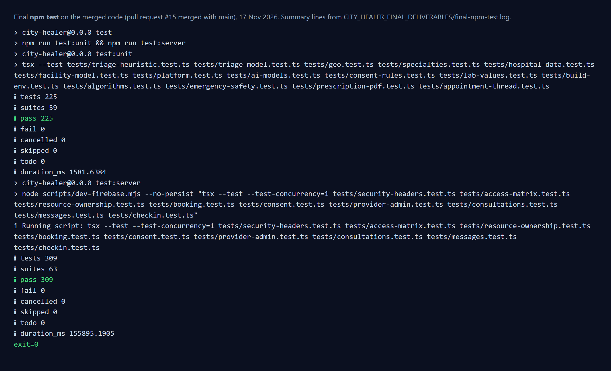

# Milestone 8 – Testing, Evaluation and Performance

**Project:** City Healer · **Repository:** github.com/Raghav-prog-max/city-healer
**Rubric criterion:** Project Implementation – Implementation & Demonstration of Modules (evidence that modules work)
**Version:** final draft, 17 Nov 2026, describing `origin/main` at `55443ec`. Every number below names its source and time.

All performance figures are **local measurements**: Windows 11, Intel Core Ultra 9 185H (22 logical CPUs), 34 GB RAM, Node v25.2.1, local Firebase emulators, with the load generator on the same machine. They are not production figures.

---

## 8.1 Abstract

City Healer is tested at three levels:

- **Unit tests** of shared logic, models and algorithms.
- **Server tests** that start throwaway Firebase emulators and call the real HTTP API.
- **Evaluation scripts** written for the system audit and re-run on the final code.

The final `npm test` passed 225 unit tests and 309 server tests, with 0 failures and exit code 0 (`../final-npm-test.log`). That run used the code of PR #15 merged with `main`, which is everything except the client-only PR #16. After PR #16, `tsc` was clean and the unit suite again passed 225/225.

The final local backend audit (16 Nov 2026, 23:07 UTC) found the following:

- 0 % errors in every load-test row.
- Triage, which the first audit measured at about 51 requests per second (CPU-bound), now serves 306 requests per second at concurrency 1, with p95 5.0 ms.
- Exactly one booking was created out of 20 simultaneous attempts in every round.
- Security checks: 25 of 25 pass on the corrected audit script (23:26Z); the earlier 23:07Z run recorded 19 of 23. The four checks marked FAIL are explained in 8.12.3: the server under test ran in development mode, and two probes target routes that were deliberately removed.

## 8.2 Objectives

1. Show that each Milestone 3 measure of success has an automated test.
2. Record the measured quality of each AI component, with its source.
3. Record performance under stated conditions, before and after the changes.
4. List what has not been measured.

## 8.3 Introduction

Milestone 3 (O6) set a target of "all 85 access-control and ownership test cases pass". The suite now has 534 executed tests (225 unit + 309 server). The audit's scripts were re-run on the final code on 16 Nov 2026 between 22:57 and 23:07 UTC: `eval_ai.ts`, `eval_emergency.ts` and `backend_audit.ts`.

## 8.4 Requirements

| Measure of success (Milestone 3) | Test evidence |
|---|---|
| O1: red flags always CRITICAL | `tests/emergency-safety.test.ts`; `tests/triage-heuristic.test.ts`; `tests/algorithms.test.ts` (A1, A2) |
| O2: top-3 by department and distance | `tests/algorithms.test.ts` (A5); `tests/access-matrix.test.ts` "recommended hospitals have a department for the condition" |
| O3: own beds only | `tests/access-matrix.test.ts` "HOSPITAL may write the bed census -> 200" and the facility-route tests (PR #12) |
| O4: booking, wait, chat, prescription and PDF | `tests/booking.test.ts`, `tests/consultations.test.ts`, `tests/messages.test.ts`, `tests/checkin.test.ts`, `tests/prescription-pdf.test.ts` |
| O5: SOS | `tests/access-matrix.test.ts` "a hospital desk sees and updates only the SOS alerts routed to its own facility"; `tests/consent.test.ts` (SOS is exempt from consent) |
| O6: privacy | `tests/access-matrix.test.ts`, `tests/resource-ownership.test.ts`, `tests/consent.test.ts` |
| O7: fallback | `tests/algorithms.test.ts` (A9) |

## 8.5 Methodology

- **Runner.** Node's test runner through `tsx --test`.
- **Unit suite** (`test:unit`, `package.json` on `origin/main`):
  - Triage and models: `triage-heuristic`, `triage-model`, `ai-models`, `facility-model`.
  - Data and geography: `geo`, `specialties`, `hospital-data`.
  - Platform and readers: `platform`, `lab-values`.
  - Consent and build: `consent-rules`, `build-env`.
  - Added in PRs #13–#15: `algorithms`, `emergency-safety`, `prescription-pdf`, `appointment-thread`.
- **Server suite** (`test:server`). Throwaway Auth and Firestore emulators are started first. These files then run one after another: `security-headers`, `access-matrix`, `resource-ownership`, `booking`, `consent`, `provider-admin`, `consultations`, `messages`, `checkin`.
- **Mutation-style checks.** PR #11 broke each guard in turn and confirmed that a test failed each time.
- **Multi-lens reviews.** These were run before merging PR #11 (9 findings) and PR #15 (9 findings), and all findings were fixed.
- **Audit scripts.** `audit_scripts/eval_ai.ts`, `eval_emergency.ts` and `backend_audit.ts` were re-run on the final code.

## 8.6 Architecture of the test set-up

```
npm test
 ├─ test:unit   → tsx --test tests/<15 unit files>                      (no network)
 └─ test:server → dev-firebase.mjs --no-persist (throwaway Auth + Firestore emulators)
                    └─ tsx --test --test-concurrency=1 tests/<9 server files>
```

## 8.7 Implementation: test inventory

The final executed totals are 225 unit tests (`final-npm-test.log` line 356) and 309 server tests (line 831). The new suites, with the PR that added each:

| File | Suite | PR | Covers |
|---|---|---|---|
| `tests/algorithms.test.ts` | unit | #13 | A1–A14, 36 tests |
| `tests/emergency-safety.test.ts` | unit (moved into `npm test` by #13) | P0.1 / #13 | 60 critical messages, crisis wording, false positives |
| `tests/prescription-pdf.test.ts` | unit | #14 | PDF content and paging |
| `tests/appointment-thread.test.ts` | unit | #15 | Message-thread logic |
| `tests/security-headers.test.ts` | server | #14 | Headers, production CSP and HSTS, JSON 400, write limits |
| `tests/messages.test.ts` | server | #15 | Thread access, posting, safety notices, read state |
| `tests/checkin.test.ts` | server | #15 | IST day, access, check-in window, ordering, visit state |

The earlier suites are unchanged in purpose: access-matrix, resource-ownership, booking, consent, provider-admin, consultations and the unit files. `tests/voice-commands.test.ts` was removed together with the legacy module (PR #12).

## 8.8 Algorithms under test

See Milestone 7 (7.8, 7.11).

## 8.9 Technology stack

- Node test runner (`tsx --test`).
- Firebase Emulator Suite.
- `tsc --noEmit` (`npm run lint`).
- The audit scripts in TypeScript.
- Vite for the production build.

## 8.10 Screenshots



PENDING: Figure 26. The full text of the run is already in `../final-npm-test.log`.

## 8.11 Test cases (selected)

| TC | Description | Expected | Test name |
|---|---|---|---|
| TC8-01 | No token on a guarded route | 401 | access-matrix: "anonymous callers are rejected on every guarded route" |
| TC8-02 | Retired HS256 token | 401 | access-matrix: "a token from the retired sign-in (HS256 with the old hardcoded secret) -> 401" |
| TC8-03 | Self-escalation | 403 | access-matrix: "cannot escalate own role -> 403 and role is unchanged" |
| TC8-04 | Removed SQLite routes | 404 for patient, doctor and admin | access-matrix: "`${method} ${route}` -> 404 for patient, doctor and admin" |
| TC8-05 | Concurrent booking | One success | booking: "a slot is booked once, even when two patients try at the same moment" |
| TC8-06 | Consent lookup fails | Refused | consent: "a failed lookup is not remembered: the next request checks again" |
| TC8-07 | Malformed JSON | JSON 400 `INVALID_JSON` | security-headers: "malformed JSON is a JSON 400 INVALID_JSON without the parser message" |
| TC8-08 | Production headers | HSTS and CSP | security-headers: "production adds HSTS and a CSP limited to self, Firebase Auth, Google Fonts and the image host" |
| TC8-09 | Write limit | 429 with Retry-After | security-headers: "the 4th record write in the window is a 429 with Retry-After" |
| TC8-10 | Message read state | A red flag posted after the doctor's fetch stays unread | messages: "a read covers only what the screen showed: a red flag posted after the doctor's fetch stays unread and urgent" |
| TC8-11 | IST day boundary | A 00:30 IST slot falls on its IST day | checkin: "a 00:30 IST slot is on its IST day, the day after its UTC date" |
| TC8-12 | Critical safety set | All escalate | emergency-safety: "every critical message escalates in triage (`n` messages)" |

## 8.12 Actual results

### 8.12.1 Test execution history

| Date (2026, UTC) | Code | Unit | Server | Source |
|---|---|---|---|---|
| 16 Nov (first audit) | Before PR #5 | 109/109 | 128/128 | `results/test_summary.json` |
| 16 Nov | PR #8 | 162 | 182 | PR #8 body |
| 16 Nov | PR #9 | 162 | 203 | PR #9 body |
| 16 Nov | PR #10 | 162 | 225 | PR #10 body |
| 16 Nov | PR #11 | 162 | 244 | PR #11 body |
| 16 Nov | PR #12 | 157 | 228 | Coordinator's final facts (the PR body defers to a merge comment) |
| 16 Nov | PR #13 | 193 | 231 | PR #13 body (before the emergency-safety suite was added) |
| 16 Nov | PR #14 | 207 | 239 | PR #14 body (agent-reported) |
| 16 Nov | **PR #15 merged with `main` (final)** | **225 pass, 0 fail** | **309 pass, 0 fail** | `../final-npm-test.log` (unit 1.6 s; server 155.9 s; exit 0) |
| 16 Nov | After PR #16 | 225 pass | Not re-run (client-only change) | Coordinator's final facts; `tsc` clean |

### 8.12.2 Coverage

The only coverage figure is from the first audit: lines 97.06 %, scoped to the modules loaded by the unit tests (`results/test_summary.json`). It excludes the server and the frontend, so it is not a whole-project figure. Whole-project coverage has not been measured.

### 8.12.3 Security probes (`results/backend_audit.json`, 23:07 UTC)

| Probe | Result |
|---|---|
| Security checks | 19 PASS, 4 FAIL, out of 23 |
| Firestore client rules | Own profile read 200; everything else 403 (other profile, own profile write, auditLogs, doctors, doctorSlots write, appointments, doctor write) |
| Concurrent booking | 20 patients per round; every round gave exactly 1 × 201 and 19 × 409 |
| Server log lines containing message text | 0 |

The four checks marked FAIL:

1. Content-Security-Policy header present.
2. Strict-Transport-Security header present.
3. The legacy SQLite booking route refuses an unverified directory doctor (returned 404).
4. The legacy booking route refuses a past date (returned 404).

Checks 1 and 2 probe a server running in development mode. By design, CSP and HSTS are sent only in production (`server/httpHardening.ts:32-50`), and the production behaviour is covered by the security-headers test "production adds HSTS and a CSP …". Checks 3 and 4 probe routes that PR #12 deliberately removed, so 404 is the intended answer.

Re-run after correcting the script (2026-11-16T23:26Z, results/backend_audit.json): the header checks now probe a production-mode API server for CSP and HSTS and confirm no CSP in development, and the two legacy probes now expect the retired routes to answer 404. Result: 25 of 25 security checks pass. The 23:07Z run (19/23) is kept as results/backend_audit_2026-11-16T2307Z.json; its load-test figures are the ones quoted in this report.

### 8.12.4 AI evaluation (final run, 22:57 UTC)

See Milestone 7 (7.7). In summary:

| Measure | Result |
|---|---|
| Triage, public test | 95.3 % |
| Triage, fresh test | 93.6 % (96.8 % when it answers) |
| Intent, held-out | 93.8 % |
| Copilot route accuracy | 81.1 % |
| Copilot emergency recall / false positives (audit set) | 100 % / 4.8 % |
| Safety set, recall | 100 % on 60 critical messages |
| Safety set, false positives | 5.7 % (2 of 35) |
| Lab-report reader | 96.4 % precision and recall |
| Entity extraction | F1 88.2 % |

### 8.12.5 Backend performance (local, 23:07 UTC)

Error rate was 0 in all 40 rows of `load_tests`. Server working set: 228–349 MB. Cold start to healthy: 4.05 s (first audit: 9.0 s).

| Endpoint | c | req/s | p50 ms | p95 ms | p99 ms |
|---|---|---|---|---|---|
| `GET /api/health` | 1 | 2,169 | 0.4 | 0.8 | 1.9 |
| 〃 | 50 | 4,771 | 7.5 | 27.5 | 30.2 |
| `GET /api/hospitals` (990 listings, SQLite) | 1 | 550 | 1.7 | 2.5 | 5.7 |
| 〃 | 50 | 776 | 60.1 | 86.5 | 99.7 |
| `GET /api/v1/doctors` (Firestore) | 1 | 66 | 15.4 | 20.8 | 34.2 |
| 〃 | 50 | 1,256 | 37.8 | 52.6 | 55.5 |
| `POST /api/v1/nlp/analyze` | 1 | 563 | 1.4 | 2.9 | 7.4 |
| 〃 | 50 | 1,733 | 28.1 | 37.2 | 39.7 |
| `POST /api/v1/copilot/chat` | 1 | 294 | 3.0 | 4.6 | 8.4 |
| 〃 | 50 | 615 | 77.5 | 104.9 | 124.3 |
| `POST /api/symptoms/check` (triage) | 1 | 306 | 2.9 | 5.0 | 12.4 |
| 〃 | 50 | 595 | 83.6 | 100.9 | 106.2 |
| `POST /api/v1/documents/extract` (1 KB) | 1 | 872 | 1.1 | 1.6 | 2.2 |
| 〃 | 50 | 1,439 | 23.4 | 91.8 | 104.1 |
| `GET /api/v1/appointments/mine` (Firestore) | 1 | 64 | 15.5 | 18.9 | 28.7 |
| 〃 | 50 | 632 | 57.5 | 152.9 | 156.3 |

The full table at concurrency 1, 5, 10, 25 and 50 is in `results/backend_audit.json`.

**Comparison with the first audit** (same machine, 16 Nov 2026):

| Measure | First audit | Final audit |
|---|---|---|
| Triage at c = 1 | 51 req/s, p95 23.2 ms | 306 req/s, p95 5.0 ms |
| Copilot at c = 50 | p95 999 ms | p95 105 ms |
| `/api/hospitals` at c = 1 | 40 req/s | 550 req/s |
| `/api/hospitals` payload | 918 KB | 51 KB |

The reason for the improvement is not documented in any PR body read for this report. PENDING: the team should state which change produced it, for example caching or the payload change, before attributing it.

The Firestore-backed routes are slower at concurrency 1, for example 64 req/s for `/appointments/mine`. Emulator latency is not representative of production Firestore (audit PERFORMANCE).

### 8.12.6 Frontend build (`npx vite build` on `main`, coordinator's final facts)

| Output | Size | Gzipped |
|---|---|---|
| Main JS chunk | 691.9 kB | 197.0 kB |
| jsPDF lazy chunk | 390.6 kB | 128.8 kB |
| Main CSS | 61.6 kB | 13.5 kB |
| Total `dist/` | 1.9 MB | – |

Build time: 5.8 s. At the first audit, `dist/assets` was 3.2 MB in total and included a 1.61 MB legacy chunk.

Paint metrics were not re-measured on the final build. The last figures are from the first audit: desktop LCP 180 ms (warm), mobile LCP 1,156 ms (warm), CLS 0. PENDING: re-measure paint metrics, optionally with Lighthouse.

## 8.13 Limitations

- All tests ran on local emulators. Nothing has run against a real Firebase project, and nothing is deployed.
- There is no end-to-end browser suite (Playwright). Browser checks are manual walk-throughs recorded in PR bodies.
- The production CSP has been tested for content only, not in a browser (PR #14).
- The post-vs-cancel race test may not catch the regression it targets (PR #15).
- The AI test sets are small and mostly team-written. The emergency set is a draft and has not been reviewed by a clinician.
- Performance figures are local best cases.
- `backend_audit.ts` still contains two probes for removed routes and runs the server in development mode.

## 8.14 Conclusion

The final automated run is clean: 534 tests, 0 failures. Fresh evaluations and load tests on the final code show the AI and safety behaviour holding, and the formerly CPU-bound routes are now several times faster. The open items are an end-to-end browser suite, an updated audit script, a browser check of the production CSP, and testing on a real deployment.

## 8.15 References

[25] repository; [28] audit. Node.js, "Test runner," https://nodejs.org/api/test.html (to be checked).
