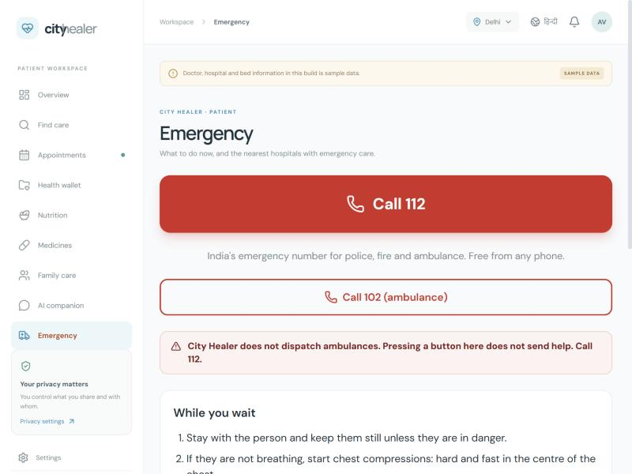
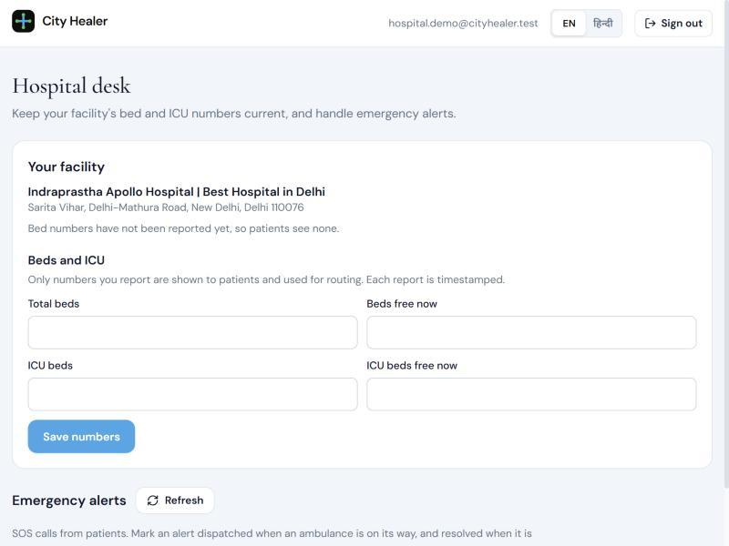
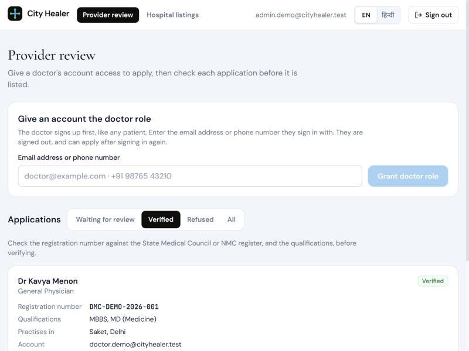
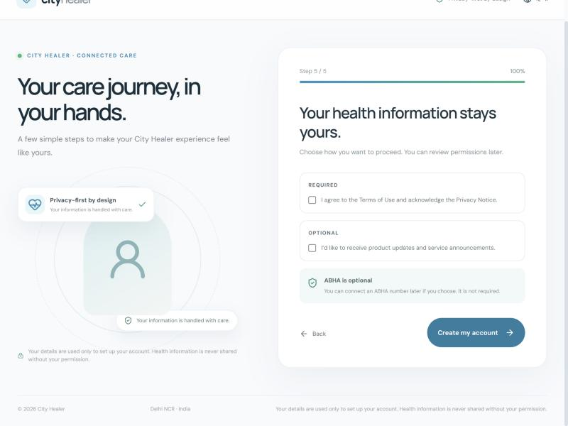
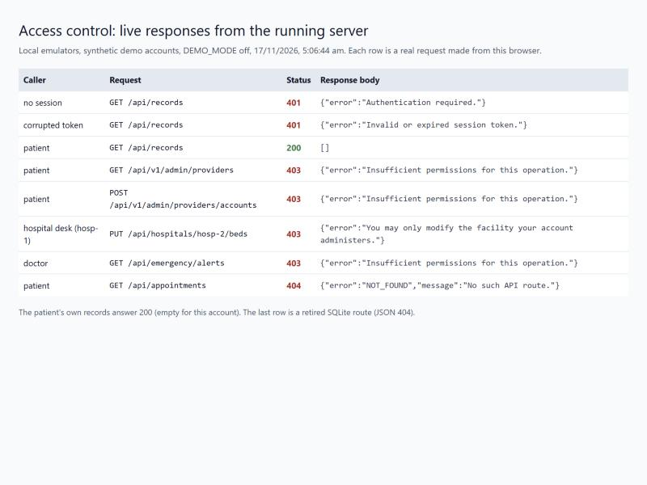

# Milestone 9 – Security, Deployment and Reliability

**Project:** City Healer · **Repository:** github.com/Raghav-prog-max/city-healer
**Rubric criteria:** Project Implementation – Synchronization of Design & Implementation; Implementation & Demonstration of Modules
**Version:** final draft, 17 Nov 2026, describing `origin/main` at `55443ec`. The system has **not been deployed** and has **not been run against a real Firebase project**.

---

## 9.1 Abstract

City Healer handles health data, so every layer of its security design starts from "deny":

- **Headers.** Security headers on every response; HSTS and a strict CSP in production.
- **Errors.** JSON error bodies with no parser text or stack.
- **Write limits.** Fixed-window limits per user on bookings, records, reports, orders and SOS.
- **Identity.** A verified Firebase ID token, checked for revocation.
- **Roles.** Taken only from administrator-set custom claims.
- **Consent.** A server-side gate for patients that refuses access when consent cannot be checked.
- **Ownership.** Checked in route handlers and inside Firestore transactions.
- **Data access.** Firestore rules that close every collection to client SDKs except a patient's own profile and consents.

The first system audit (16 Nov 2026) rated authentication 78/100 and security 50/100. Every critical, high and medium finding from that audit is now closed in code. Three gaps remain open: demo mode is not refused in production, data rights (export and deletion) are missing, and nothing has been deployed. The production CSP has not been tried in a browser.

## 9.2 Objectives

1. O6: keep patient data private across the four roles.
2. O7: keep the system usable without external AI services.
3. Make release builds refuse unsafe configurations.
4. Record open issues honestly.

## 9.3 Introduction

Milestone 2 (2.5) planned bcrypt password hashing, JWT sessions, rate limits, owner-scoped records and twelve named attack payloads (`security_spec.md`). Sign-in moved to Firebase Authentication, and the rate limits were rebuilt around per-user writes (PRs #13 and #14).

Several of the twelve payloads in `security_spec.md` name collections that no longer exist, such as `/activeChats`. PENDING: map each payload to the current test that covers it.

## 9.4 Requirements

| ID | Requirement | Source |
|---|---|---|
| SR1 | No patient data without a verified session | O6 |
| SR2 | No self-escalation of role | `security_spec.md` Payload 1 |
| SR3 | Patients see only their own data; doctors see it only through a booking; hospitals see only their own facility and alerts | O6; PRs #10, #12 |
| SR4 | Health data is processed only with current consent | Audit S-02 |
| SR5 | A slot can be booked only once | Booking integrity |
| SR6 | An emergency is never blocked by consent or AI failure | `consent.ts:22-31`; O7 |
| SR7 | Abuse resistance on writes | Audit S-05 |
| SR8 | Production image carries no local or emulator settings | Audit S-04 |

## 9.5 Methodology

1. Threats were taken from `security_spec.md` and the audit's probes (`audit_scripts/backend_audit.ts`).
2. Each control is enforced on the server.
3. Each control is tested against throwaway emulators.
4. The audit's findings were fixed in separate pull requests, each with its verification stated.
5. The probes were re-run on the final code (16 Nov 2026, 23:07 UTC).

## 9.6 Architecture: security layers at `55443ec`

| Layer | Control | Source |
|---|---|---|
| Headers | nosniff, `X-Frame-Options: DENY`, Referrer-Policy, Permissions-Policy (`camera=()`, microphone and geolocation self), COOP same-origin; in production, HSTS (1 year) and `PRODUCTION_CSP` | `server/httpHardening.ts:17-50`; mounted `server.ts:77` |
| Errors | Malformed JSON → `400 INVALID_JSON`; unknown `/api` route → JSON 404; unhandled error → JSON 500 without stack | `httpHardening.ts:52`, `:59`; `server.ts:1467`, `:1495` |
| Write limits | Per user (per IP when anonymous): bookings, records, hospital reports and orders 120 per 10 min; SOS 10 per 10 min; 429 with Retry-After | `server.ts:181-187`; `server/rateLimit.ts:26` |
| AI quota | 300 requests per hour per user | `server.ts:209-237` |
| Authentication | `verifyIdToken(token, true)`: 401 if the token is rejected, 503 if Firebase cannot be reached | `identity.ts:47`; `server.ts:128-168` |
| Consent | Patients only; default-deny with exact exemptions; refuses when consent cannot be checked | `server/firebase/consent.ts:1-60` |
| Authorisation | `requireRole`; roles from custom claims set by admins only | `server.ts:190`; `identity.ts:1-37` |
| Ownership | Booking, consultation, message and check-in transactions; SOS alerts scoped to the desk's own facility | `server/firebase/*.ts`; `server.ts:1114-1160` |
| Data rules | Firestore deny-by-default, including the messages subcollection | `firebase/firestore.rules` |
| Audit trail | `auditLogs` record the action and ids only | Test "the audit trail records the act, not the diagnosis or medicines" |

## 9.7 Implementation

### 9.7.1 Audit findings and their status

| Finding | Severity | Fix | PR / commit | Evidence |
|---|---|---|---|---|
| S-01 Missed self-harm and overdose messages | Critical | Emergency patterns in English, Hindi and Hinglish, plus crisis wording | `fba9063` | 100 % recall on the dev and held-out sets in all post-fix runs (`emergency_eval.json`) |
| S-02 / S-03 Consent not enforced; consent gate failed open | High | `requireConsent`; client re-reads consent and shows a retry | PR #5 | `tests/consent.test.ts` |
| BUG-006/009 Wrong lab values pre-filled | High | New reader and confirm step | PR #6 | Field precision and recall 96.4 % in the final evaluation |
| S-04 `.env.local` included in Docker builds | High | `.dockerignore`, build arguments, release-build checks | PR #7 | `tests/build-env.test.ts` |
| S-05 No general rate limiting | Medium | Write limits | PR #14 | security-headers: "the 4th record write in the window is a 429 with Retry-After" |
| S-06 No CSP or HSTS | Medium | Production CSP and HSTS | PR #14 | security-headers: "production adds HSTS and a CSP …". Content test only; **not tried in a browser**. |
| S-08 Legacy localStorage database | Medium | Legacy app deleted | PR #12 | `src/utils/api.ts` is absent from `origin/main` |
| S-10 HTML error pages | Low | JSON 400, 404 and 500 | PRs #12, #14 | security-headers: "malformed JSON is a JSON 400 INVALID_JSON without the parser message" |
| BUG-008 Two appointment systems | Medium | Firestore only | PRs #8, #10, #12 | Removed-route 404 tests |

### 9.7.2 Still open

| Item | Status |
|---|---|
| S-07: nothing refuses `DEMO_MODE` in production (`consent.ts:10` comment) | Open. It must not be set on a deployment. |
| S-09: unused `firebase-applet-config.json` and stale root `firestore.rules` | Both removed on 17 Nov 2026. The active rules are `firebase/firestore.rules`, which `firebase.json` deploys. `firebase-applet-config.json` remains in the git history; restricting or deleting its Google Cloud project is for the project owner |
| S-11: binary content named `.txt` is accepted | Open (`ai_ml_evaluation.json` failure mode `binary_named_txt = extracted`) |
| S-13: no data export or deletion; no retention policy | Open |
| Order route trusts `prescriptionAttached` (`server.ts:1017`) | Open (PR #14 "Not done") |
| Production CSP not tried in a browser; phone sign-in must be checked on a deployed build | Open (PR #14) |
| Check-in composite index (`doctorId`, `startsAt`) | Must be deployed before production (PR #15) |

### 9.7.3 Deployment

- `Dockerfile` and `railway.json` run `node dist/server.cjs`. `DB_PATH` must point to a mounted volume (README "Deploying").
- A release build fails if emulator mode is on or the web config is missing. The production server refuses to serve a frontend built for another target (`shared/buildEnv.ts:29`, `:45`; PR #7).
- Final production build (`npx vite build` on `main`, coordinator's final facts):

  | Output | Size | Gzipped |
  |---|---|---|
  | Main JS | 691.9 kB | 197.0 kB |
  | jsPDF lazy chunk | 390.6 kB | 128.8 kB |
  | CSS | 61.6 kB | 13.5 kB |
  | Total `dist/` | 1.9 MB | – |

  Build time: 5.8 s.
- PENDING: an actual `docker build`, which has never been run.
- Not deployed, and no real Firebase project exists. PENDING: a staging deployment that deploys the Firestore rules and indexes and checks phone sign-in under the production CSP.

### 9.7.4 Reliability

| Mechanism | Source / evidence |
|---|---|
| AI runs in-process; the LLM path falls back offline | `server/ai/llm.ts:286`; test "A9: a timeout on every model falls back to offline" |
| Firebase unreachable → 503, not a sign-out | `server.ts:128-168` |
| A failed consent lookup is not cached | consent: "a failed lookup is not remembered: the next request checks again" |
| Booking, messages and check-in run in transactions | `server/firebase/booking.ts:143`; `messages.ts:216`; `checkin.ts:147` |
| Refusal cancellations survive partial failure and can be retried | PR #11 |
| Session restored on reload | PR #16 (`src/site/lib/session.tsx`) |
| Load tests: 0 % errors in all 160 rows of four runs; cold start 3.4–5.9 s; working set 190–373 MB | `results/backend_audit_2026-11-16T2307Z.json`, `results/backend_audit.json` (23:26Z), `results/backend_audit_2026-11-17T0019Z.json` and `results/backend_audit_2026-11-17T0100Z.json` (local) |

Weaknesses:

- The server is a single process.
- Rate-limit windows and AI monitoring are kept in memory and reset on restart.
- There is no error monitoring or alerting.
- Notifications are queued but never delivered.

## 9.8 Algorithms

A12 (RBAC and ownership), A13 (deviation: Firebase ID tokens) and A14 (fixed-window limits). See Milestone 7 (7.8).

## 9.9 Technology stack

Firebase Authentication and the Admin SDK, Firestore security rules, Express middleware (no new dependencies for hardening, per PR #14), zod, Docker, Railway configuration, and the Firebase Emulator Suite.

## 9.10 Screenshots

Figure 27 shows real responses from the running server (local emulators, `DEMO_MODE` off, 17 Nov 2026).

## 9.11 Test cases

| TC | Threat | Expected | Test |
|---|---|---|---|
| TC9-01 | No token | 401 | access-matrix: "anonymous callers are rejected on every guarded route" |
| TC9-02 | Role escalation | 403, role unchanged | access-matrix: "cannot escalate own role -> 403 and role is unchanged" |
| TC9-03 | Stale session after a role change | Revoked | access-matrix: "an administrator's role change revokes the account's existing sessions" |
| TC9-04 | Another facility's SOS alerts | Hidden, and cannot be updated | access-matrix: "a hospital desk sees and updates only the SOS alerts routed to its own facility" |
| TC9-05 | Another user's message thread | 404, same as an unknown id | messages: "another patient, another verified doctor and an unknown id all get the same 404" |
| TC9-06 | Staff posting to a patient thread | 403 | messages: "anonymous callers get 401, admin and hospital accounts 403, on every route" |
| TC9-07 | Spoofed sender | Refused | messages: "the body is exactly { text }: sender, authorUid, empty, blank and over-long text are refused" |
| TC9-08 | Consent exemptions | Look-alike paths still gated | consent: "exemptions are exact: look-alike paths and other methods are still gated" |
| TC9-09 | Write flooding | 429 | security-headers: "the 4th record write in the window is a 429 with Retry-After" |
| TC9-10 | Error leakage | JSON 400 with no parser text | security-headers: "malformed JSON is a JSON 400 INVALID_JSON without the parser message" |
| TC9-11 | Booking race | 1 created, 19 conflicts per round | booking test; `backend_audit.json` `concurrent_booking` |
| TC9-12 | Firestore client access | 403 except reading one's own profile | `backend_audit.json` `firestore_rules_probe` |

## 9.12 Actual results

- **Final run:** 225 unit and 309 server tests pass, 0 fail (`../final-npm-test.log`).
- **Final local backend audit** (23:07 UTC):
  - The Firestore rules probe denied every client access except reading one's own profile.
  - Every concurrent-booking round created exactly 1 booking.
  - No log line contained message text.
  - 25 of 25 checks pass on the corrected audit script (23:26Z). The earlier 23:07Z run recorded 19 of 23. The 4 marked FAIL come from development-mode headers and probes of removed routes (Milestone 8, 8.12.3).
- Done: the audit now probes a production-mode server for CSP and HSTS and expects 404 from the removed routes. It records 25 of 25 checks passing (23:26Z, and again 17 Nov 00:19Z).
- PENDING: an updated security score. The 78/100 and 50/100 scores date from before PRs #5–#16.

## 9.13 Limitations

- Not deployed. No real Firebase project. No penetration test beyond the audit probes.
- The CSP is untested in a browser.
- Demo mode is not refused in production.
- The SQLite file is unencrypted at rest.
- Data-principal rights (export, deletion) are not implemented.
- The emergency rules are pattern rules on a draft set that no clinician has reviewed.
- Notifications are not delivered, and SOS does not dispatch an ambulance; the app tells users to call 112.

## 9.14 Conclusion

Access control, consent and booking integrity are backed by tests and independent probes. Every critical, high and medium finding from the audit is now closed in code. Real-world use would still require a staging deployment with a browser-checked CSP, deployed rules and indexes, refusal of demo mode, data-rights features and clinician review.

## 9.15 References

[19]–[21] as in Milestones 1–4; [26]–[29] as in Milestone 5. Additional:

36. Google, "Firebase Security Rules for Cloud Firestore" (to be checked).
37. Digital Personal Data Protection Act, 2023, Government of India (to be checked).
38. OWASP Top 10 (to be checked).
39. W3C, "Content Security Policy Level 3" (to be checked).
