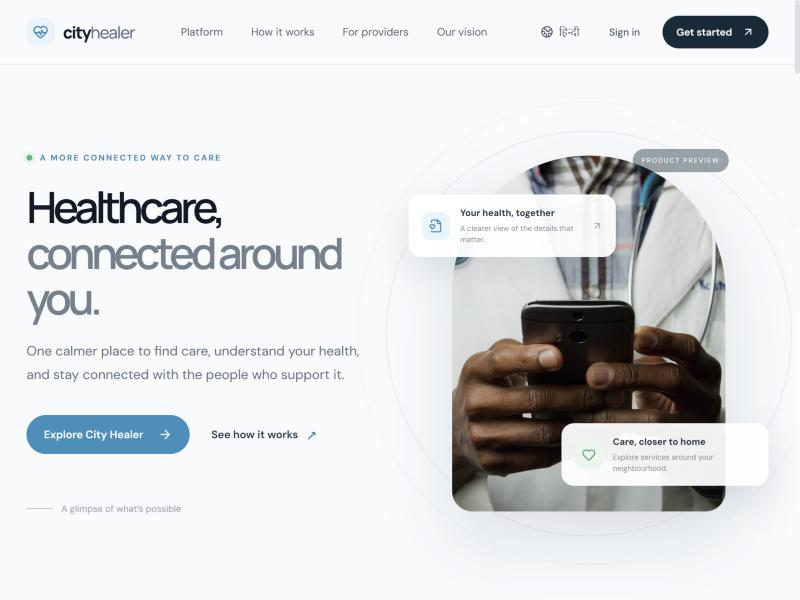
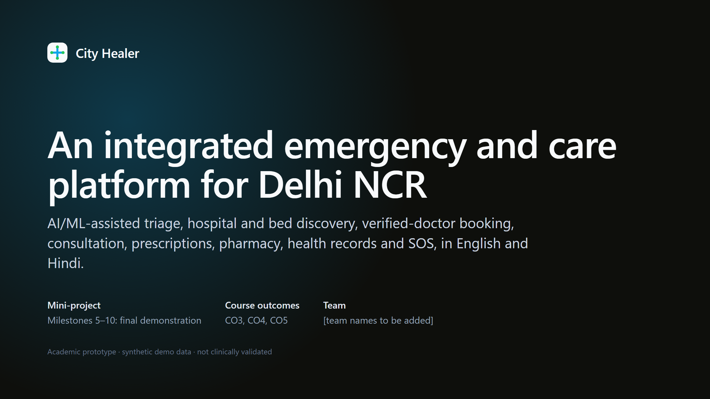

# Milestone 10 – Final System Demonstration and Documentation

**Project:** City Healer · **Repository:** github.com/Raghav-prog-max/city-healer
**Rubric criteria:** Project Report – Organization & Structure; Compliance with Prescribed Report Format; Communication – Clarity & Organization of Presentation; Contribution by Each Team Member
**Version:** final draft, 17 Nov 2026. The demonstration commit is `55443ec`.

---

## 10.1 Abstract

This milestone prepares City Healer for its final demonstration and assessment. It covers:

- the demonstration environment and the synthetic demo accounts;
- the patient journey and the staff journeys to be shown;
- a map from each demonstration step to its module, source file, test and screenshot;
- the documentation set.

The demonstration runs on local Firebase emulators with synthetic data. The final automated run passed 225 unit and 309 server tests (`../final-npm-test.log`), and 18 screenshots have been captured from the running app.

Some things will not be shown, because the system cannot do them:

- It has no real patients or hospitals.
- It does not dispatch ambulances.
- It does not deliver notifications.
- It does not take payments.

## 10.2 Objectives

1. Demonstrate every core module in one connected run (rubric: "all modules correctly implemented and demonstrated").
2. Provide a report organised in the numbered structure of Milestones 1–4.
3. Provide traceable evidence for every claim.
4. Record each member's contribution, which the team will fill in.

## 10.3 Introduction

There is no real Firebase project, so local emulators are the only supported environment. The app is started with `npm run dev`, which launches the emulators, the server and the frontend at http://localhost:3000 (README "Run it locally").

## 10.4 Requirements

| Demonstration requirement | Where it is met |
|---|---|
| Patient journey from symptoms to health record | `../DEMO_SCRIPT.md` Part A; Figures 1–10, 16 |
| Emergency handling | Part B; Figures 6, 11, 12 |
| Hospital admin and administrator | Part C; Figures 12–15 |
| Role-based access | Part D; Figure 18 |
| Hindi and Hinglish | Part E; Figures 3, 16, 17 |
| Tests pass | `../TEST_EXECUTION_LOG.md`; `../final-npm-test.log` |

## 10.5 Methodology

1. **Demonstration commit.** `55443ec`, the merge of PR #16.
2. **Test run.** `npm test` passed: 225 unit and 309 server tests, 0 fail (`../final-npm-test.log`).
3. **Demo accounts.** Created in the local emulators. All are synthetic:

   | Account | Role and details |
   |---|---|
   | `patient.demo@cityhealer.test` | Patient, Delhi, consent given |
   | `doctor.demo@cityhealer.test` | Verified General Physician "Dr Kavya Menon", registration DMC-DEMO-2026-001 (synthetic) |
   | `hospital.demo@cityhealer.test` | Hospital desk for `hosp-1` |
   | `admin.demo@cityhealer.test` | Administrator |

   The password and a one-command way to recreate the accounts are in `scripts/seed-demo.ts` in the repository. The password is deliberately not written in these deliverables.

   PENDING: `scripts/seed-demo.ts` exists in the local checkout but was not yet on `origin/main` at `55443ec`. Confirm that it is merged.
4. **Rehearsal.** PENDING: rehearse `../DEMO_SCRIPT.md` twice and record pass or fail for TC10-01 to TC10-08.
5. **Backup.** PENDING: record a backup screen video.

## 10.6 Architecture

As in Milestone 5 (5.6). The demonstration exercises every layer: browser → Firebase Auth emulator → Express guards → Firestore emulator and SQLite.

## 10.7 Implementation: demonstration-to-evidence map

| Step | Module | Source | Test | Figure |
|---|---|---|---|---|
| Landing, sign-in | Identity | `src/site/auth/SignInPage.tsx` | access-matrix | 1, 17 |
| Dashboard | Patient app | `src/site/dashboard/PatientDashboard.jsx` | booking "patients see only their own appointments, with the doctor's name" | 2, 16 |
| Symptoms → triage | Triage | `server.ts:1176`; `llm.ts:286`; `triageModel.ts:180` | algorithms A1–A4; emergency-safety | 3 |
| Top-3 hospitals | Ranking | `shared/hospitalRanking.ts:42` | algorithms A5 | 4 |
| Doctor, booking | Booking | `booking.ts:141` | booking "a slot is booked once, even when two patients try at the same moment" | 7 |
| Same-day check-in | Check-in, A7 | `checkin.ts:147`; `waitTime.ts:56` | checkin suite | 5, 7 |
| Consultation messages | Messages | `messages.ts:216` | messages suite | 6, 8 |
| Prescription and PDF | Consultation | `consultations.ts:137`; `prescriptionPdf.ts:95` | consultations; prescription-pdf | 9 (writing form: 20, PENDING) |
| Medicine order | Demo pharmacy | `PharmacyOrder.tsx`; `server.ts:970` | order integrity | 10 (confirmation: 21, PENDING) |
| Health record | Wallet | `WalletPage.tsx` | lab-values | 9 |
| SOS | Emergency | `EmergencyPage.tsx`; `server.ts:1059` | access-matrix SOS scoping | 11 |
| Hospital desk | Hospital workspace | `HospitalWorkspace.tsx`; `server.ts:515`, `:573` | access-matrix bed census and facility route | 12, 13 |
| Admin | Provider review, listings | `AdminProviders.tsx`, `AdminHospitals.tsx` | provider-admin | 14, 15 |
| Role-based access, 404 | Guards | `SiteRouter.tsx:91-104` | access-matrix | 18 |

## 10.8 Algorithms

The demonstration shows these live:

- the emergency rules, with the crisis notice in messages (A2, A3);
- language detection (A4);
- hybrid triage with an offline engine (A1, A9);
- hospital ranking (A5);
- the wait-estimate range (A7);
- the write limits (A14), which can be explained on request.

## 10.9 Technology stack

As in Milestone 5 (5.9). Measurement machine for the final runs: Windows, Intel Core Ultra 9 185H (22 logical CPUs), 34 GB RAM, Node v25.2.1 (`backend_audit.json` `environment`).

PENDING: record the demonstration machine, if it differs from the measurement machine.

## 10.10 Screenshots

All 18 captured screenshots are listed in `../README.md`.

PENDING: Figure 28.

## 10.11 Test cases (demonstration acceptance)

| TC | Check | Pass condition |
|---|---|---|
| TC10-01 | English red-flag message | CRITICAL, SOS card and "Call 112" |
| TC10-02 | Self-harm message in Hindi | Crisis wording with 14416 and 112, in Hindi |
| TC10-03 | Hinglish non-urgent symptom | Condition, urgency, specialist, top-3 hospitals (Figures 3–4) |
| TC10-04 | Second patient tries a booked slot | Refused |
| TC10-05 | Emergency wording in a message | Automatic notice and red banner (Figure 6) |
| TC10-06 | Doctor prescribes | Prescription in the wallet, PDF downloads (Figure 9) |
| TC10-07 | Patient opens `/en/provider` | Refused |
| TC10-08 | Unknown URL | 404 page (Figure 18) |

PENDING: pass or fail for each check, recorded during rehearsal.

## 10.12 Actual results

| Item | Status |
|---|---|
| Automated tests | Final run passed (Milestone 8, 8.12.1) |
| Screenshots | 18 captured from the running app |
| Browser walk-throughs | Recorded in PR #15 (check-in, emergency notice) and PR #16 (reload stays on the page) |
| Rehearsal and live demonstration | PENDING: date and pass/fail per step |

## 10.13 Limitations of the demonstration

- Local emulators and synthetic accounts only. Hospital beds and directory doctors are sample data, and the UI labels them as such.
- SOS does not reach any ambulance; the app tells the user to call 112.
- Notifications are queued, not delivered.
- The pharmacy is a demo with no payment or delivery. The order route trusts the `prescriptionAttached` flag.
- The prescription PDF cannot render Devanagari.
- Hindi wording needs review by a fluent speaker.
- The LLM path is off during the demonstration because no key is set.

## 10.14 Documentation set and team contributions

| Document | Purpose |
|---|---|
| `../FINAL_PROJECT_REPORT_DRAFT.md` | Consolidated report |
| `../FINAL_PRESENTATION_OUTLINE.md` | Slide outline |
| `../VIVA_QUESTIONS_AND_ANSWERS.md` | Viva preparation |
| `../RUBRIC_TRACEABILITY.md` | Rubric → evidence matrix |
| `../EVIDENCE_REGISTER.md` | Claim → evidence |
| `../DEMO_SCRIPT.md` | Demonstration script |
| `../TEST_EXECUTION_LOG.md`, `../final-npm-test.log` | Test runs |
| `docs/ALGORITHMS.md` (repository) | A1–A14 reference |

### 10.14.1 Team contributions

**TO BE FILLED IN BY THE TEAM.** The rubric criterion "Contribution by Each Team Member" is assessed from this section.

| Member (name, roll no.) | Role | Modules / documents contributed | Evidence (commits, PRs, slides) |
|---|---|---|---|
| PENDING | PENDING | PENDING | PENDING |
| PENDING | PENDING | PENDING | PENDING |
| PENDING | PENDING | PENDING | PENDING |
| PENDING | PENDING | PENDING | PENDING |

Note for the team: the git history shows who authored each commit. PR bodies #5–#16 end with a "Generated with Claude Code" line, and `ml/README.md` states that the supplementary training and test sentences were written with AI assistance. Describe each member's actual work and how AI assistance was used, as the institution requires.

## 10.15 References

As in `../FINAL_PROJECT_REPORT_DRAFT.md`.
